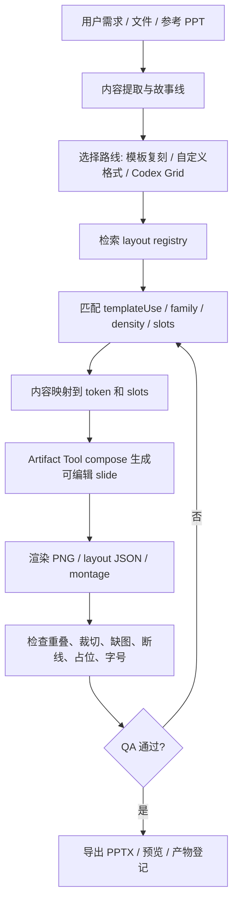

# Codex Presentations 与 Artifact Tool 技术分析

日期：2026-06-26  
目的：把 Codex presentations 的能力拆成可复刻的工程规格，用于后续完善 QwenPaw/DClaw 的 `presentation_builder`，但不把 Codex 私有源码原样搬入项目。

## 结论

Codex presentations 的强能力不是单个 PPT 生成脚本，而是四层组合：

1. **Skill 编排层**：判断走模板复刻、用户指定格式，还是默认 Codex Grid 布局库。
2. **80 套布局资产层**：`template-registry.json` + 80 个 slide module + preview PNG + tokens/slots/density/typography 合约。
3. **Artifact Tool 运行时层**：`@oai/artifact-tool` 提供可编辑 PPT 对象模型、compose/autolayout、导入、检查、渲染、导出。
4. **QA 闭环层**：最终必须渲染预览、检查布局、生成接触表，并修正重叠、裁切、断线、缺图、错误占位等问题。

因此，QwenPaw 要对齐 Codex 的能力，核心不是“复制 80 个文件”，而是建立同等的 **布局注册表、内容槽位合约、可编辑对象运行时、渲染检查和业务编排闭环**。

## 本次查看范围

本次查看的是本机 Codex 插件与运行时文件：

| 范围 | 位置 | 作用 |
| --- | --- | --- |
| presentations skill | `/Users/zu/.codex/plugins/cache/openai-primary-runtime/presentations/26.623.12021/skills/presentations/SKILL.md` | PPT 生成工作流、QA 要求、工具选择规则 |
| Codex Grid layout library | `/Users/zu/.codex/plugins/cache/openai-primary-runtime/presentations/26.623.12021/skills/presentations/assets/artifact-md/codex-grid-layout-library/` | 80 套布局库、设计 token、内容 token、预览、compose 模块 |
| Artifact Tool docs | `/Users/zu/.codex/plugins/cache/openai-primary-runtime/presentations/26.623.12021/skills/presentations/artifact_tool/` | `@oai/artifact-tool` API 说明 |
| Artifact Tool package | `/Users/zu/.cache/codex-runtimes/codex-primary-runtime/dependencies/node/node_modules/@oai/artifact-tool/` | Codex primary runtime 私有依赖 |
| QwenPaw 当前实现 | `/Users/zu/Documents/workes/qwenpaw/src/qwenpaw/agents/tools/presentation_builder.py` | 当前服务侧 PPT 生成工具 |

注意：`@oai/artifact-tool` 的 `package.json` 标记为 `private: true`，并且位于 Codex primary runtime 依赖目录，不是 presentations 插件内部可独立复用的普通包。生产项目不应直接依赖或复制该私有实现。

## Codex Grid 布局库结构

布局库目录包含：

| 文件/目录 | 作用 |
| --- | --- |
| `ARTIFACT.md` | 布局库说明：白底、黑字、灰色结构、克制商务风格 |
| `design_tokens.json` | 颜色、字体、尺寸等设计 token |
| `content.json` | 示例内容 |
| `manifest.json` | artifact 元信息 |
| `artifact-tool-compose/template-registry.json` | 80 套布局的机器可选 registry |
| `artifact-tool-compose/slide-01.mjs` 到 `slide-80.mjs` | 每页布局的 compose 实现 |
| `artifact-tool-compose/runtime.mjs` | frame/token 帮助函数 |
| `artifact-tool-compose/styles.mjs` | 文本样式、段落样式 |
| `artifact-tool-compose/content-tokens.json` | 内容 token |
| `assets/previews/slide-XX.png` | 每个布局预览图 |
| `assets/previews/layout-library.png` | 80 布局总览图 |

`ARTIFACT.md` 明确说明这个库用于 presentation-native deck，不是把页面截图塞进 PPT。设计方向是克制的白底商务系统：画布白色、主文字黑色、结构面板浅灰，颜色只用于证据、图表或一个明确高亮。

## Registry 数据模型

`template-registry.json` 中每个模板都有这些核心字段：

| 字段 | 含义 | 对 QwenPaw 的启发 |
| --- | --- | --- |
| `templateId` | 模板唯一标识 | 生成、追踪、QA、日志都应基于稳定 id |
| `slideNumber` | 对应布局编号 | 便于预览和调试 |
| `templateUse` | 用途，如 process、metrics、cover | 作为第一层布局选择器 |
| `useWhen` / `avoidWhen` | 适用/避免场景 | 让模型选模板有明确判断依据 |
| `layoutFamily` | 布局家族，如 two-column-content | 控制版式多样性 |
| `contentRoles` | 内容角色 | 连接大纲结构与布局槽位 |
| `slots` | 文本/区域/图片槽位 | 内容映射、缺字段检查、QA 的基础 |
| `densityBudget` | 文本密度预算 | 控制内容拆页或压缩 |
| `typographyBudget` | 字号和层级预算 | 防止为了塞内容把字号压坏 |
| `assetSlots` | 图片/媒体槽位 | 保证生成图、用户图能真正用进 PPT |
| `previewPng` | 模板预览 | 供模型和用户选择视觉方向 |
| `component` | 对应 compose 模块和导出函数 | 运行时调用入口 |
| `textFlows` | 文本流结构 | 支持自动布局、换行、列布局 |
| `majorRegions` | 主要视觉区域 | 用于对象检查和区域级 QA |

本次解析到的 registry 规模：

| 指标 | 数值 |
| --- | ---: |
| 模板数量 | 80 |
| 画布尺寸 | 1280 x 720 |
| 总 slot 数 | 1035 |
| 必填 slot 数 | 330 |
| 有图片 slot 的模板 | 9 |
| 图片 slot 数 | 9 |

按 `templateUse` 分布：

| 用途 | 数量 |
| --- | ---: |
| process | 36 |
| two-column | 14 |
| metrics | 8 |
| image-hero | 7 |
| agenda | 5 |
| data-table | 5 |
| cover | 2 |
| chart | 2 |
| content | 1 |

按 `layoutFamily` 分布：

| 布局家族 | 数量 |
| --- | ---: |
| two-column-content | 50 |
| metric-led | 8 |
| agenda-list | 5 |
| table-evidence | 5 |
| split-image-text | 5 |
| full-bleed-image | 2 |
| cover-image-field | 2 |
| chart-evidence | 2 |
| multi-region-content | 1 |

slot role 分布：

| slot role | 数量 |
| --- | ---: |
| region | 534 |
| body | 186 |
| title | 135 |
| footer | 74 |
| label | 60 |
| stat | 37 |
| hero | 9 |

这个结构说明：Codex 的 80 套布局库本质是一个可搜索、可评分、可映射、可渲染的布局数据库。

## Artifact Tool 能力面

`@oai/artifact-tool` 的包信息：

| 字段 | 值 |
| --- | --- |
| package | `@oai/artifact-tool` |
| version | `2.8.14` |
| private | `true` |
| module type | `module` |
| 主入口 | `dist/artifact_tool.mjs` |
| JSX 入口 | `dist/presentation-jsx/index.mjs` |
| 关键依赖 | `skia-canvas`, `@oai/walnut` |

从 API 文档与导出能力看，Artifact Tool 提供的是一个 presentation object model：

| 能力 | 说明 | 对齐目标 |
| --- | --- | --- |
| 创建 deck | `Presentation.create({ slideSize })` | QwenPaw 需要统一 16:9 画布坐标系 |
| 添加 slide | `presentation.slides.add()` | slide 作为对象容器 |
| 原生对象 | shape、textbox、image、table、chart、connector | PPT 里保持可编辑，不做整页截图 |
| Compose | row、column、grid、layers、paragraph、box 等 | 用自动布局减少手工坐标错误 |
| JSX runtime | 类似 React/JSX 的布局声明 | 可作为未来 JS runtime 方向 |
| 导入 PPTX | `PresentationFile.importPptx()` | 支持模板读取和局部编辑 |
| Inspect/Resolve | 查找对象、稳定引用、定位文本/图片/表格/图表 | 支持对模板或生成结果做结构化修改 |
| 渲染 | slide PNG、deck montage、layout JSON | QA 与用户预览的基础 |
| 导出 | `PresentationFile.exportPptx()` | 最终交付可编辑 PPTX |

Artifact Tool 的关键价值不只是写 PPTX，而是 **生成前有布局模型，生成后能渲染和检查**。这正是我们目前 PPT 质量不稳定、图片没有被使用、刷新后产物分类混乱等问题的底层解法。

## Codex 生成链路

Codex presentations 的完整链路可以抽象为：



这个链路里，布局选择、内容槽位、渲染检查是闭环。没有这个闭环，只靠模型调用一次 Python 生成 PPT，很容易出现“说用了图但 PPT 没用上”“缩略图有但正文没有”“产物全是图片”等问题。

## 当前 QwenPaw `presentation_builder.py` 状态

当前工具已经不是最初的极简 MVP，已经包含一些对齐 Codex 的方向：

| 已有能力 | 状态 |
| --- | --- |
| 结构化 slide spec | 已有 `SlideSpec`、`ThemeSpec`、`ImagePlacement` |
| 布局目录 | 已有 13 类布局：image_hero、section、cards、process、metrics、table、two_column、agenda、comparison、roadmap、quote、architecture、content |
| 主题系统 | 已有基础颜色、字体、深浅色控制 |
| 图片资产检查 | 已有 required assets、image placement、media usage QA |
| 模板路径 | 已有 `template_path` |
| 模板 clone/edit | 已有 `template_frame_map`、rewrite、replace-image 等 XML 级目标 |
| 渲染 QA | 已有 LibreOffice + pdftoppm 渲染预览能力 |
| 严格 QA | 已有 `strict_qa` 与 final delivery 自动启用思路 |
| 交付 | 已有 PPTX 输出和文件发送链路 |

但它仍然缺少 Codex presentations 的核心规模化能力：

| 缺口 | 当前表现 | 目标 |
| --- | --- | --- |
| 80 套布局资产 | 目前约 13 类手写布局 | 建立 80 套 registry + preview + slot 合约 |
| 布局选择器 | 主要靠 layout 字段和启发式判断 | 根据用途、密度、slot、视觉方向评分选择 |
| 预览驱动 | 缺少内置布局预览库 | 每个布局有 preview，可给模型和用户选 |
| slot 合约 | slide spec 与布局耦合较松 | 每个布局声明必填/可选文本、图片、图表、表格槽位 |
| Compose/autolayout | 手写 XML 坐标较多 | 建立行、列、栅格、层叠等布局 DSL |
| 对象级 inspect | XML 级 QA，缺少统一对象模型 | 生成后能输出 layout JSON/object tree |
| 导入后编辑 | 当前是 XML selector/clone-edit | 目标是稳定对象引用 + 局部编辑 |
| 图表/表格 | 可生成基础结构，但能力有限 | 原生 chart/table 作为一等对象 |
| QA 可解释性 | warnings 有，但不够面向模型修复 | QA 输出应能反推布局选择和内容拆分 |
| 产物分类 | 图片可能被当成主产物堆出 | PPT/PDF 主产物与过程图片/支撑图片分层 |

## 推荐工程架构

不要把 Codex 私有源码复制进项目。建议在 QwenPaw 中做能力等价的实现：

```text
src/qwenpaw/agents/presentation_engine/
  registry/
    layout_registry.json
    previews/
    tokens.json
  schema.py
  layout_selector.py
  content_mapper.py
  compose/
    primitives.py
    layouts/
      slide_001.py
      ...
  renderers/
    pptx_xml.py
    preview.py
  qa/
    inspect.py
    render.py
    rules.py
  artifact_index.py
```

### 1. Registry 层

建立我们自己的 `layout_registry.json`：

```json
{
  "templateId": "qwenpaw-grid#slide-001",
  "templateUse": "process",
  "layoutFamily": "two-column-content",
  "useWhen": "用于流程、阶段、路线图、方法论",
  "avoidWhen": "内容需要大量图片或复杂表格时避免",
  "densityBudget": {
    "level": "moderate",
    "maxTextTokens": 6,
    "maxImageSlots": 0
  },
  "typographyBudget": {
    "titleMinPx": 33,
    "bodyMinPx": 14
  },
  "slots": [
    { "name": "title", "role": "title", "required": true },
    { "name": "step_1", "role": "body", "required": true },
    { "name": "footer", "role": "footer", "required": false }
  ],
  "assetSlots": [],
  "previewPng": "previews/slide-001.png",
  "component": {
    "module": "layouts.slide_001",
    "exportName": "build_slide_001"
  }
}
```

### 2. Layout Selector 层

输入：

- 用户任务意图：商务汇报、咨询方案、实施路线、培训手册等。
- slide intent：cover、agenda、process、metrics、table、architecture。
- 内容规模：标题数量、正文长度、表格行列、图片数量。
- 视觉方向：用户在对话中选择的方案 A/B/C。
- 必须使用的素材：GPT Image2/imagegen 输出图、用户上传图、参考 PPT 截图。

输出：

- 模板 id。
- 内容拆分建议。
- 未满足槽位。
- 需要重新生成或补齐的素材。

### 3. Compose 层

先不需要完全复刻 JS Artifact Tool，可以在 Python 建立轻量 DSL：

| Primitive | 用途 |
| --- | --- |
| `Frame` | 坐标、尺寸、边距 |
| `TextBox` | 文本和样式 |
| `ImageBox` | 图片 contain/cover/crop |
| `ShapeBox` | 面板、线条、强调块 |
| `Row` / `Column` | 自动分配横向/纵向空间 |
| `Grid` | 卡片、指标、图标矩阵 |
| `Layer` | 背景、叠加、标注 |
| `NativeTable` | 表格对象 |
| `NativeChart` | 图表对象 |

现有 XML 写法可以作为第一版 renderer，但布局代码不应继续散落在一个超长 `presentation_builder.py` 中。

### 4. QA 层

最终交付前必须做：

| QA 项 | 失败处理 |
| --- | --- |
| PPTX 可打开 | 直接失败 |
| slide 数一致 | 直接失败 |
| 必填图片已进入 PPT media | final delivery 直接失败 |
| 图片没有被引用 | final delivery 直接失败 |
| 文本过多导致弱页 | 自动拆页或换 dense 布局 |
| 对象重叠 | 自动换布局或缩减内容 |
| 渲染预览为空白 | 直接失败 |
| PPT/PDF 主产物分类 | 图片不能挤掉 PPT/PDF |

### 5. Artifact 分类

presentation_builder 的输出应分三类：

| 类型 | 展示位置 | 说明 |
| --- | --- | --- |
| `primary_presentation` | 任务主制品 | PPTX、PDF |
| `chat_visual_preview` | 对话流中展示 | 视觉方案图、缩略图，点击放大 |
| `supporting_asset` | 右侧制品折叠/次级 | 生成图、背景图、图标、渲染 QA 图 |

这能解决当前“刷新后全是图片、PPT/PDF 不突出”的业务问题。

## 迁移路线

### Phase 0：文档与边界确认

- 明确不直接复制 Codex 私有实现。
- 明确目标是能力等价：80 布局、slot 合约、可编辑对象、渲染 QA、产物分类。

### Phase 1：Registry 化当前 13 类布局

- 把 `LAYOUT_CATALOG` 从 Python 常量抽成 JSON registry。
- 给每个布局补 `useWhen`、`avoidWhen`、`slots`、`densityBudget`、`typographyBudget`。
- 生成 preview PNG。
- selector 根据 slide intent 自动选布局。

### Phase 2：扩展到 40 套可用布局

- 覆盖商务 PPT 高频页型：封面、目录、章节、问题、洞察、方案、能力图、流程、路线图、矩阵、指标、案例、团队、报价、收尾。
- 每套布局必须有 preview、slot 合约、QA 示例。
- 对接对话内视觉方案缩略图展示。

### Phase 3：扩展到 80 套并加入对象树 QA

- 建立完整 80 template registry。
- 每个输出 slide 生成 object tree/layout JSON。
- QA 能指出具体对象、页码、原因和建议。
- 产物主次分类稳定，刷新前后一致。

### Phase 4：Artifact Tool 等价运行时

- 评估是否需要 JS sidecar service。
- 如果需要，做自研 `presentation-artifact-runtime`，而不是依赖 `@oai/artifact-tool`。
- 提供 create/import/inspect/render/export 的稳定服务 API。

## 验收标准

| 项 | 标准 |
| --- | --- |
| 布局库 | 至少 80 个 registry entry，且有 preview |
| 可编辑性 | PPT 中文本、图片、形状、表格、图表可编辑 |
| 图片使用 | 视觉方案图或用户指定图必须进入对应 slide |
| QA | final delivery 默认 render QA + strict QA |
| 产物 | PPTX/PDF 是主制品，过程图是支撑制品 |
| 对话展示 | 视觉方案图在流式回答正文中可见，点击可放大 |
| 稳定性 | 刷新后 artifact 分类和对话内图片展示一致 |
| 可维护性 | 布局、选择器、渲染器、QA 分模块维护 |

## 对当前问题的解释

之前测试里出现的几个问题，本质都能映射到上述缺口：

| 问题 | 根因 |
| --- | --- |
| 生成图展示在产物区，但对话正文没有图 | 缺少 `chat_visual_preview` 类型和 markdown/image block 渲染链路 |
| PPT 没用上生成图 | slot 合约和 required asset mapping 不够强 |
| 刷新后主产物变成一堆图片 | artifact 类型和排序规则不稳定 |
| PPT 观感仍不如 Codex | 13 类布局 + 手写 XML 难以替代 80 registry + compose runtime |
| 详细操作框文字重叠 | 前端 runtime progress 的 token/label 缺少换行和间距约束，这和 PPT 引擎不同，但同属可视 QA 问题 |

## 最重要的边界

可以学习和复刻：

- registry 结构。
- slot/density/typography 合约。
- compose/autolayout 思想。
- render/inspect/QA 闭环。
- PPTX/PDF 主产物与支撑图片分层。

不建议直接复制：

- `@oai/artifact-tool` 私有包。
- Codex 插件中的 minified runtime。
- 原始 80 个 slide module 源码。
- Codex 内部工具链路径和运行时约束。

正确路径是：把 Codex 能力拆成公开可描述的规格，在 QwenPaw 内部用自有代码实现等价能力。
