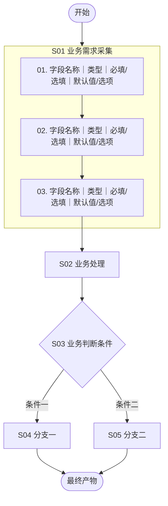
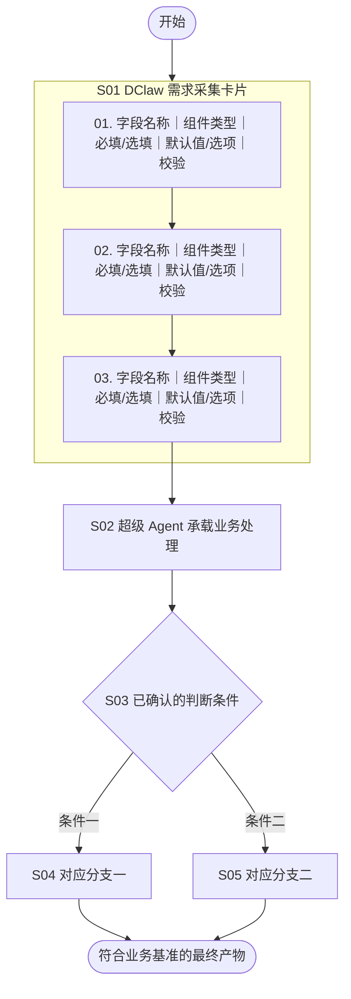

# DClaw Super Agent 开发与优化

安装了解本 Skill，或从需求、现有材料开发、续建、优化 DClaw Super Agent 时使用。它负责 Codex 到 DClaw 的接入与持续发布链路；各 Agent 的业务方法和效果由各自项目定义与验证。保留当前 Skill 名称作为现有项目和会话的兼容入口。

Skill 版本：`1.9.13`（EC 工作区版）。本工作区的维护源位于项目根目录 `dclaw-super-agent-porting/`，与平台及专家源码一起在同一个 `main` 提交。开始工作时先读 [references/knowledge-base.md](references/knowledge-base.md)，再按模式读取对应参考文件。知识库用于定位正式材料，不代替目标 DClaw 当前发布的唯一开发标准和 DevKit Schema。

本工作区的开发与维护直接读取此目录，遵守根目录 `AGENTS.md` 的共享 `main` 规则；不克隆旧 Skill 仓库，也不向旧仓库回传或推送。本版默认目标是 EC 实例 `https://dclaw.rouhigh.com`，实际认证下载和发布仍以用户指定的目标实例及其正式回执为准。先检查当前目标、工作区和已有材料；只了解 Skill 时不创建 Agent 项目，开展具体 Agent 工作时按模式路由。现有未发布项目沿用，借用另一项目材料时先保护原件并建立工作副本。平台认证使用目标实例账号，Git 凭据不能代替 DClaw 认证。

首次读取并验证安装后，即使开发方只要求了解 Skill，也按[下一步决策与续接](references/next-step.md)展示一屏内的通用链路总览和当前状态；不要求先选 Agent 模式。有具体 Agent 工作时，Codex 在对话中直接展示该项目适用的大节点及状态，之后每次进入或离开大节点都更新当前位置和下一步；不能只把节点写在文件里或给参考文件链接。开发方不必先理解 Node 0–8 或自行组织测试、诊断和发布步骤。先查当前工作区与材料、判断模式和当前停点，说明已证实结果与下一动作，然后执行已授权且自己能完成的动作；每次取得新结果后按该参考文件继续，直到当前门禁放行、明确阻断或确实需要开发方的一项决定。缺少会改变下一步的材料时才问一项，不用泛泛的“请继续测试/准备完整项目”结束当前轮。按 README 为已安装 Skill 配置取新版任务；有 Agent 项目时再配置反馈补漏任务，记录实际创建结果。定时能力不可用时按包内后备规则继续，不把计划写成已运行。

本 Skill 的既有流程来自已确认的开发实践。遇到尚未确定的业务或平台决策时，停止对应决定，向当前项目的负责人说明问题；得到明确答案后再写入该项目或共享 Skill。已有正式合同或用户指令能够确定的内容直接执行，不重复询问。

通用接入流程不得依赖开发者电脑上安装了 DClaw 客户端、浏览器自动化、`computer-use` 或本机已有登录会话。开发者以普通 DClaw 账号通过目标实例的正式认证接口获取开发工具链，再使用官方 Developer Pack/DevKit 的 CLI；交互输入凭证和令牌处理见 [知识库](references/knowledge-base.md)。

## 强制适用规则

- 所有 DClaw Super Agent 的首次开发（含使用已有材料）、续建、恢复、重做、密封和上传都必须使用本 Skill。
- 每个 Agent 必须以自己的真实需求、源包或当前项目为输入，独立走完适用节点。
- 首次发布统一使用 `new-development`：没有现成材料就从需求建立 Node 0；使用另一项目代码、ZIP 或说明时先保护原件并建立副本，以这些材料预填 Node 0，再走同一套 Node 1–8。已发布专家的原身份更新使用 `optimization`，从当前激活版进入受影响节点。
- 已开发过的 Agent 续建或返工时也必须使用本 Skill：核对已有节点证据和目标实例当前材料，从首个未放行或受影响节点继续；不得只凭旧会话结论跳过盘点、流程对照或后续节点。
- 每次接手、取得测试结果或平台回执时，按[下一步决策与续接](references/next-step.md)核对当前停点，执行能由 Codex 完成的下一动作；只询问确实缺失的决定或材料。
- 引导覆盖安装、模式选择、源材料保护、Node 0–8 的适用门禁、故障定位、回传和后续更新。对每个卡点先给当前项目一条可执行的续接动作及其通过或停止条件；只挂起受阻分支，其他独立工作继续。业务目标和验收标准仍由 Agent 项目决定，本 Skill 不替开发方设计业务方法。
- 在宣称平台能力不可用或要求开发方补做步骤前，先核本 Skill 的限制是否确属目标实例正式合同或当前项目要求。正式合同或官方示例已允许某路径，而 Skill 的固定条件挡住它时，按[卡点回传与每日补漏](references/blocker-feedback.md)记为待审核冲突；无需为了证明 Skill 有错而重复一次付费或有副作用的调用。按正式合同继续已授权且可执行的工作，实际成功和发布验收仍分别留证。维护方核实无依据的额外限制后修订通用规则并验证受影响路径，不误报平台缺能力。
- 进入具体 Agent 项目时展示适用 Node 0–8 的大节点路线；每个适用 Node 开始、完成、阻断或重新打开时，主动向开发方说明当前节点的通俗名称、已证实状态、Codex 正在执行的动作、通过或停止条件及下一节点。连续完成的节点可合并成一次简短进度汇报，但不能让开发方猜当前做到哪一步；不逐个内部命令、字段或普通业务回合重复讲路线。具体展示方式见[下一步决策与续接](references/next-step.md)。
- 每个适用 Node 完成、阻断或因新证据改变结论时，在当前 Agent 项目更新节点检查点；若项目设有独立总控或接入方法维护方，按已授权的协作渠道发送脱敏摘要并取得审核回执。发送与审核分开记录，具体字段和隐私边界见[下一步决策与续接](references/next-step.md)。维护方收到节点摘要或卡点时按[卡点回传与每日补漏](references/blocker-feedback.md)当次审核、落账并回传结论；定时巡检只补漏，不代替当次处理。
- 不得用其他 Agent 的依赖、流程、业务规则、测试结论或发布证据代替当前 Agent 的节点输出。
- 任何使用本 Skill 的开发者同时是 Agent 业务开发方和共享方法的反馈来源：每个实际卡住开发、发布、试跑或更新步骤的问题，以及已完成但产生明显多余成本的流程摩擦，先在当前项目记录，即使当日解决或归属未明也纳入[卡点回传与每日补漏](references/blocker-feedback.md)。可安全脱敏的卡点交本工作区维护方审核，不能脱敏的只留在专家项目，不把卡点直接定性为 Skill Bug。平台最终回执到达时立即补充原卡点及可复用结论；按项目巡检补漏。通用修订由维护方直接在本仓库 `main` 修改、验证并提交；新增全局决策仍须取得相应产品或平台负责人的确认，提交前记录依据、版本和既有 Agent 的兼容检查。
- 进入具体 Agent 接入、密封或发布工作时，从目标 DClaw 取得当前正式标准与 Developer Pack/DevKit，并核对版本和摘要；只安装了解 Skill 时不要求 DClaw 账号或开发包。Agent 工作暂无法取得正式材料时可继续独立盘点和离线开发，但不得宣称目标平台集成、密封或发布门禁已通过。
- 维护本 Skill 时，平台公开合同、开发标准、Developer Pack、DevKit 或运行行为一旦改变，必须在同一变更周期核对并更新本 Skill 的适用规则、参考文件和 Node 门槛；平台交接文档不能代替 Skill 本体。记录依据版本、兼容结论和验证结果；未完成同步时不得宣称新合同的专家开发链路已就绪。

## 模式路由

先确认开发方当前要做的事。只安装或了解 Skill 时停在安装阶段，不创建 Agent 项目或启动 Node。新专家首次发布及其未发布项目续建都用 `new-development`，区别只在是否提供可复用的来源材料；不要让开发方在“新建/移植”之间选。修改同一已发布专家用 `optimization`。旧项目记录中的 `migration` 是历史来源标签，保留原记录，后续沿 `new-development` 从首个未放行或受影响节点继续，复用仍有效的证据。进入 Agent 工作后记录当前流程和材料来源：

| 模式 | 适用情况 | 事实基准 | 起始节点 |
|---|---|---|---|
| `new-development` | 新专家首次发布；可从需求开始，也可利用现有材料 | 本轮确认的需求和范围；有来源时附原件、副本及可复用行为证据 | Node 0 或未发布续建的首个未放行节点 |
| `optimization` | 更新同一已发布专家 | 当前激活版、真实运行证据和已批准的改动范围 | 影响分析后的首个受影响 Node |

### 现有代码包入口

开发方可以提供代码仓库、本地工程、ZIP、平台导出包，或只给部分源码与说明；也可以只给出当前工作区可见的材料。Codex 先只读识别候选材料的来源、身份与版本（可取得时）、代码、构建输入、测试和发布证据；材料及本轮目标明确时直接继续，多份候选且目标不明时才问选哪份。材料和专家源码默认保存在开发方自己的项目工作区；仅在项目所有者明确授权全部仓库协作者读取并核定范围后，才可作为单独源码包入仓，也不要求开发方先取得管理员账号。使用现有材料不要求原项目已开发完整、签名或有历史测试；旧签名包只在实际核验旧发布状态等具体情形才按证据索取。

选定后按目标路由：以独立身份新发专家，无论沿用原业务还是重新定义目标，都进入 `new-development`；沿用原业务时把确认纳入本轮范围的行为作为 Node 0 约束，借用结构时重新确认业务目标。修改同一已发布专家才进入 `optimization`，先核当前激活版、原 `agent_id` 和发布权限；只看代码或视觉风格时只读材料，不启动制包节点。若目标未说清，只问“要发布新专家，还是更新原专家”。只有 `agent/` 运行目录的快照可作开发起点，但不是原始签名包或完整开发项目；缺少构建材料、测试或 signer/所有者权限时逐项补证，不把改 `agent_id` 或重压 ZIP 当成已可上传。

借用另一项目材料时，按[统一开发流程](references/new-development.md)保护原件、复制副本并盘点能证明的行为；续建当前未发布项目则沿用已有工作区与证据，没有来源时直接从需求建立项目。三者共用 Node 0–8 和目标 DClaw 正式材料。源项目能否运行、业务做到哪一步，不是开始盘点和开发的门槛。

副本只提供独立的开发输入；DClaw 平台合同、签名、上传、授权和激活仍按正式材料检查。

- 首次发布或续建未发布项目时读 [references/new-development.md](references/new-development.md)；旧记录引用 `references/migration.md` 时，该文件只作兼容跳转。
- 执行 `optimization` 时必须读取并使用 [references/optimization.md](references/optimization.md)。
- 澄清本轮范围、绘制流程图或建立测试追踪时，读取并使用 [需求澄清与节点追踪](references/discovery-trace.md)；该文件随 Skill 分发，不要求另装访谈工具。
- 不要读取不适用模式的附加材料。

### 在 Codex 中持续工作

换对话、换开发者或隔一段时间继续时，先读当前 Agent 项目的需求或源行为基线、已完成节点证据、未解决问题、当前正式发布回执和回滚版本；再核对目标实例当前标准与工具链。聊天记录只作线索，不代替项目文件或平台回读。

- 尚未首次发布：统一按 `new-development` 从首个未放行或因变化失效的节点继续；旧记录的 `migration` 标签保留为来源事实，不改写历史或重做仍有效的证据。
- 已发布后修改或修复：以当前正式版本和本轮批准范围进入 `optimization`，形成新版本并走受影响节点、回归、密封和上传门禁；不覆盖旧发布物。
- 每个节点在当前 Agent 项目写明 Skill 版本、模式、事实基准、执行结果、证据位置与阻断。收到真实使用反馈时按[试跑问题处理规则](references/runtime-feedback.md)自查并分流。Skill 自身更新不会自动修改或发布 Agent。

### 需要平台方配合时

先用当前 Agent 项目的正式工具和证据自查、处理开发方职责内的问题，再查已确定的平台沟通人和转交方式。提出公共能力或合同变更前，按[试跑问题处理规则](references/runtime-feedback.md)核对通用性、现役专家影响与版本兼容；单个 Agent 的业务差异不得直接改成平台规则。需要平台配合时，Codex 根据现有证据写好一份可直接执行的完整请求：给出已知标识、受影响范围、平台侧需自行完成的定位与修复、部署及回归、适用的生产只读验收、回滚条件、脱敏边界和最终回执。归属暂不明时也在同一任务中请平台先查其权限内的证据；若确认属平台职责，继续处理至可核对结果，不把内部日志查询或中间诊断拆给转交人。只有确实缺少开发侧独占的包、权限或业务决定且平台无法取得时，才一次列明准确阻断与所需输入。若由开发者或项目方转交技术老师，Codex 在同一回复中直接给出成稿，并说明最终回复可随时回传当前 Agent 项目对话；不得让转交人组织技术指令或解释中间字段。只有沟通方式确实未知且影响交接时才询问；没有外发授权时不代发。

在当前 Agent 项目已有的进度或交接记录中留一条可见待办：请求主题、当前状态（待转交/待回复/已收到待核）、回传位置、依赖它的节点和证据位置；交付请求不等于已转发，取得回复也不等于已核实。等待期间可以继续当前项目中不依赖该回复的工作，也可以继续其他不相关任务；只挂起受影响节点。切换任务或回到该节点时查看待办并简要提醒，不在每条无关回复中反复催问。收到平台回复后，按[下一步决策与续接](references/next-step.md)核对证据、更新待办并恢复受影响节点；不能把技术归因任务交给转交人。故障场景还须按[试跑问题处理规则](references/runtime-feedback.md)执行。

## 全局规则

### 1. 保持业务事实基准

- `new-development`：只实现 Node 0 已确认的本轮需求和范围，不把推测、示例或实现便利变成产品需求。有来源材料时保护原件、仅在副本开发；来源能证实且声明沿用的行为构成本轮约束，未验证部分标待证。未经具体差异批准，不借适配删减或改变已确认的范围内行为。
- `optimization`：只修改已批准的目标和范围，范围外的现有业务行为保持不变。

客户需求需要结构化采集或可信确认时，按目标实例正式合同使用 DClaw 卡片；其他交互由当前 Agent 的业务需求决定。卡片只改变采集载体，不得自行改变已确认的字段含义、业务流程和完成条件。

新增需求或后续优化通过新的明确范围和版本单独迭代。
首次发布可以只包含开发方明确声明、可运行且可测试的最小范围；业务效果与功能丰富度由该 Agent 的项目方决定，不是本通用 Skill 额外设置的发布门槛。来源材料中已有步骤若暂不纳入本轮沿用范围，须记录具体差异并取得项目方批准，不能静默删减。

当前项目若需要设计头像或展示图，可按需查看[现有专家视觉样张](references/visual-reference.md)。样张只帮助把握视觉风格，不是上传规格、强制模板或复用其他专家名称与图标的授权；没有视觉制作任务时跳过。

### 2. 统一业务执行骨架

所有模式都按以下骨架实现和验收：

1. 当前节点按业务需要采集所需事实；需要卡片时使用 DClaw 卡片，信息足够后立即进入执行，不要求开始时一次采集全部需求。
2. 密封超级专家统一编排大模型、DClaw 公共能力、第三方 API 和按需本地助手，并保留全部业务判断、调用条件、返工策略和完成判据。第三方业务 API 的供应商选择、凭证引用、请求参数、幂等、轮询、重试、费用和结果解释全部属于 Agent 侧。
3. 执行产生新的必要问题或确认项时，回到对应交互节点；已取得的值继续复用。
4. 需要最终视频或其他内容产物时，超级专家先确定素材、脚本、制作方案和验收标准，再按任务性质选择公共 AIGC、远程能力或本地助手。
5. 只有本地文件、浏览器、桌面软件、大文件传输或高资源任务才调用本地助手；本地助手只处理 Agent 确定的素材和加工参数，以及按正式合同由 Agent 或 Host 授权交付的公开或短时预签名 URL，不得持有第三方长期 Key，不得创建、轮询或解释第三方业务任务；DClaw AIGC 本地化按标准 2.54 由 Host 预检并向助手交付稳定公开 OSS 地址，Agent 不取得下载 URL；没有本地任务时保持 `none`。
6. 超级专家必须检查真实产物；不合格时回到对应业务节点返工，合格后才交付。视频、音频和其他大文件最终必须落到客户本地任务或输出目录，DClaw 和 Agent 只接收产物引用、摘要和媒体事实。

不同 Agent 可以省略不适用的第三方调用、本地执行或内容制作分支，但不得改变上述职责边界，也不得把可选分支统一强加给所有 Agent。

### 3. 生成 DClaw 密封包

按照 DClaw 超级专家密封加密包规则打包，使完成开发的 Super Agent 可以上传和更新到 DClaw。

## Node 0：本轮需求与范围基线

`new-development` 用本节点形成本轮需求与范围基线。借用另一项目材料时记录原件与副本；有来源时盘点实际可见的已实现/未实现行为、声明沿用的范围和已有测试，从材料预填已知事实，只问影响下一步的缺口，不强迫重新定义原业务。原项目不能运行也不阻断复制和盘点。`optimization` 不用 Node 0 覆盖当前已发布版本。

先从用户请求、业务材料、示例和已经明确的约束中提取已知内容。按[需求澄清与节点追踪](references/discovery-trace.md)逐题确认真正影响范围、业务流程、依赖判断或验收的缺口，每答即时写入当前 Agent 项目；不先发送一整套问卷。

Node 0 必须形成一份可追溯的本轮基线，至少包含：

- Agent 身份：`agent_id`、显示名称和版本起点；
- 目标客户、使用场景和业务目标；
- 客户输入、字段含义、必填条件和输入顺序；
- 最终产物、交付位置和成功、失败判据；
- 从开始到交付的业务步骤、分支、重试和人工操作；
- 第三方 API、账号、Secret、费用和时限约束；
- 可能涉及本地文件、下载、上传、音视频处理或高资源消耗的步骤；
- 首批目标操作系统和设备范围；
- 真实验收案例及其预期结果。

Node 0 的输出必须清楚区分“已确认”“从材料直接得出”和“待确认”，并给本轮业务步骤稳定编号，供 Node 1–6 对照。不得把待确认内容写成既定需求。有来源材料时还须区分已验证、仅有材料描述、未实现与未知行为，记录本轮目标与来源的差异；不把未验证部分写成已通过业务等价。只有足以逐步追踪本轮业务操作、判断依赖并定义验收时，才能进入 Node 1。

## Node 1：依赖环境盘点

### 1. 确定盘点输入

按模式使用以下输入：

- `new-development`：使用已通过的 Node 0 基线；有来源副本时同时检查本轮沿用的既有调用和已确认但尚未实现的步骤，无来源时从每个已确认业务操作推导依赖。空模板、缺失实现和未确认设想均不能代替完整依赖基准。
- `optimization`：先将当前已签名版本及其依赖证据与批准的变更逐项对照。依赖调用、目标平台、公共 Component 或其正式合同受影响时进入 Node 1；未受影响且旧证据仍能对应当前签名版时引用旧结论，不重复盘点。旧证据缺失、无法对应签名版或发现漏检时扩大到完整盘点。

首次盘点先列出事实基准中全部流程会使用的环境和依赖包，再对照 DClaw 本地助手注册表；优化复核以当前仍有效的完整清单加受影响项为范围。任一正常、可选、重试、恢复或人工复核流程会使用某项依赖，就判定为依赖。

#### 1.1 业务流程调用覆盖检查

有来源代码时不能只检查 `package.json`、`requirements.txt`、锁文件、安装目录或已经打包的二进制文件，须从入口沿本轮范围内全部业务分支检查实际执行逻辑；`optimization` 进入 Node 1 时，以已验证的当前版本覆盖记录为基线，检查受影响调用及上下游分支，旧覆盖记录缺失或失效时按完整流程补查。尚未实现的确认范围从来源材料和需求逐项推导操作。`new-development` 必须从 Node 0 的业务步骤逐项推导实际所需操作。适用范围内要记录：

- 直接或间接启动的 CLI、可执行文件、脚本、子进程和宿主工具命令；
- 动态导入的库、插件、模型、权重、字典、运行时和环境变量；
- 音视频处理、转写、识别、生成、下载、上传、浏览器和高 CPU/内存任务；
- 只在首次使用、异常重试、人工复核、可选功能或特定输入条件下执行的分支；
- 通过包装函数、Shell 命令、配置文件、提示词、Skill 或外部工具名称间接触发的本地处理。

每一项调用都必须根据实际执行位置归类：

- 本地执行所需的运行时、库、模型、工具或技术能力，必须进入 Node 1 依赖盘点；
- 明确通过远程 HTTP/MCP 等合同调用的第三方业务 API，记录为后续业务能力，不混入依赖表；
- 无法从当前模式的事实基准证明执行位置的调用，不得擅自排除。先按“依赖待确认”处理并阻断 Node 1，直到分类明确。

源宿主提供的命令名称不等于 DClaw 已具备相同能力。例如源流程调用 `mediakit audio separate-voice` 时，必须继续确认它实际完成的人声/背景分离、音轨输出和测量结果，并在注册表中找到语义等价且可调用的 Component；不能只因为它表现为宿主命令、外部工具入口或包装函数就排除。

#### 1.2 流程覆盖闭环

Node 1 必须形成“业务步骤/分支 -> 实际调用 -> 所需依赖或远程业务 API -> 处理结论”的覆盖记录。最终依赖表中的`备注建议`至少要写明对应调用或业务分支，确保每项依赖可追溯。

只有同时满足以下条件，才能宣称依赖盘点完整：

- 当前模式事实基准中的每个入口、步骤、分支、重试和可选流程均已检查；
- 每个本地技术操作都已映射到依赖表中的一行或明确的私有实现；
- 每个被排除出依赖表的外部调用都有远程业务 API 合同或其他明确证据；
- 不存在未分类、未映射或仅凭名称推断为“平台已有”的调用。

对于已有未发布项目，Node 1 同时判断当前实现和本轮确认要沿用的步骤所需环境与依赖。旧来源包缺失、目录删除或行为证据不完整，记录为 Node 2 的业务等价性风险；只有使某项必需调用无法分类时才阻断相应依赖结论。

### 2. 先判断是否依赖本地助手注册表中的组件

把当前 Agent 的依赖清单与 DClaw 本地助手注册表对照：

- 如果需要注册表中已有的组件，进入本地助手公共依赖盘点。
- 如果不需要注册表中已有的任何组件，记录为“不依赖现有本地助手组件”，跳过现有本地助手组件匹配，但仍继续盘点 Agent 自身依赖包。

跳过的是组件逐项匹配，不是取得目标实例的最新完整注册表。没有公共依赖时，确认完整注册表后可以记录“无所需公共 Component”，依赖表不必虚列公共项；尚未取得本次完整注册表时，Node 1 仍不能放行。

### 3. 判断 Agent 自身依赖是公共依赖还是私有依赖

逐项判断 Agent 自身依赖属于公共依赖还是私有依赖。

公共模块的判断标准是：将来开发其他超级 Agent 时是否可能重复使用。FFmpeg、Whisper、Python Runtime 是明确的公共模块示例。

- 只要某个库将来可能被其他 Agent 使用，就可以提出并由开发者判断是否作为公共依赖。
- 公共依赖统一由 `dclaw.super-agent-support` 插件及其配套本地助手管理；DClaw 核心不识别公共 component。
- 注册表中没有的公共依赖必须提醒 `dclaw.super-agent-support` 补充并注册为公共 component。
- 不属于公共依赖的模块判定为 Agent 私有依赖，由当前 Agent 自己管理，并随实际运行位置进入对应发布物。私有本地能力及其依赖进入独立本地能力制品，不得塞进 Super Agent 密封包。
- 如果一个私有 plug/component 依赖 Python、Node.js 等公共运行环境，Agent 包只保留该私有 plug/component；Python、Node.js 等公共运行环境由本地助手提供，不重复打进 Agent 包。

### 4. 以 DClaw 注册版本为准

`dclaw.super-agent-support` 插件必须向开发 Agent 提供已经注册的全部公共模块及其版本号，作为开发依据。

- 注册表中已有所需公共组件时，直接使用注册版本。
- 事实基准使用的版本与注册版本不同时，以注册版本为准；后续开发只能使用注册版本完成适配。
- 可以提示基准版本与注册版本存在差异。
- 版本适配不得改变已确认的业务流程和业务逻辑。

注册表中存在某个 Component，只证明平台登记了该制品，不自动证明当前 Agent 可以使用。Node 1 还必须通过公开 DevKit、Component descriptor 和 Runner 合同核对：

- Component 提供的操作语义、输入和输出能够等价覆盖源调用；
- 目标平台变体和精确版本为 `available`；
- Agent 能通过公开入口、命令、export、环境路径或声明式依赖取得所需运行文件；
- 所需的非入口 Component export、模型路径和工具路径有公开稳定的注入或解析合同；当前合同使用 DevKit `1.6.0` 的 `component_exports`，并要求 Runner `1.3.0` 或更高版本；
- 不需要读取 Runner 私有安装目录、猜测绝对路径或依赖未公开环境变量。

任一条件不满足时，即使 Component 已注册且 `status=available`，Node 1 也不能记为 `available`：已证实没有等价能力或所需版本时记 `absent`，公开调用合同或版本尚未核实时记 `unverified`，并写明原因。不得先放行到 Node 2 再验证是否可用。

### 5. 缺少公共 component 时处理受影响链路

注册表中没有所需公共 component 时，向 `dclaw.super-agent-support` 提交补充申请。公共 component 的公共性评审、分平台构建、许可证和 SBOM、签名、HTTPS 制品上传、注册表发布、版本管理、本地助手下载与安装协议全部归属 `dclaw.super-agent-support` 插件。HTTPS 对象存储或 CDN 是插件管理的制品存放介质，不改变能力归属。制品不进入 DClaw 核心镜像，也不通过 DClaw 核心转发下载流量。

在 `dclaw.super-agent-support` 完成注册并提供包含该 component 的新注册表之前，受影响链路的 Node 1 不放行，也不得将其密封或上传为已接通能力。可以继续不依赖该组件的盘点、实现和离线测试；若要缩减本次发布范围，须按当前模式逐项确认差异，再重新核对完整依赖和发布门禁。取得新注册表并确认所需 component 及其版本后，才能恢复受影响链路。

### 5.1 来源运行库与公共组件的合并规则

本节适用于使用来源材料开发的新专家和 `optimization`。盘点发现旧 Agent 专属 Python、Node.js、FFmpeg、Whisper、浏览器或其他可复用运行库时，不得直接删除旧运行库。

- 注册表已有同类公共 component：把旧运行库映射到注册版本，由当前 Agent 按注册版本适配，不重复注册旧版本。
- 注册表缺少该公共 component：保留旧制品作为迁移输入，向 `dclaw.super-agent-support` 提交补充注册申请，等待新完整注册表后继续。
- Agent 私有能力包和私有依赖继续由 Agent 管理，不合并进公共注册表。
- Agent 私有能力 artifact 由开发方控制的、客户网络可访问的 HTTPS 存储托管；正式 URL、大小和 SHA-256 冻结后才能生成并签名描述符。平台负责能力包 signer 信任登记、描述符注册和安装授权；公共 Component 的插件托管入口不自动提供给私有能力包。本轮确实包含私有能力包而缺正式 URL 时，只保留本地构建输入，不把该私有能力的 `capability-build`、`build` 或发布记为通过；仅调用平台通用 AIGC 资产本地化时按[本地化指南](references/aigc-asset-localization.md)单独判断。
- 公共 component 注册和 Agent 版本适配完成前保留旧运行库制品；是否删除旧副本是后续独立操作，必须另行确认。

### 6. 公共模块运行责任

超级 Agent 包不负责判断或处理本地助手将来能否下载、安装或使用已经声明的公共模块。

超级 Agent 相信需要使用的公共模块在运行时必须可用；没有时由插件配套的本地助手按需下载。下载、验签、安装或使用失败属于 `dclaw.super-agent-support` 插件套件的问题，与 Agent 业务实现无关。

### 7. 适用范围

本 Skill 面向目标 DClaw 正式标准支持的各类超级 Agent，不按视频、图文或行业限制。依赖、交互卡、AIGC、第三方 API、本地助手和文件交付只在当前 Agent 实际需要时进入对应节点；目标实例未提供正式合同的能力保持待核，并向平台方提出缺口。本 Skill 不替开发者决定业务方法，也不以 Skill 校验代替该 Agent 的业务验收。

### 8. 盘点后的处理方向

- 所需公共 Component 已可用时，在实际使用它的任务能力中核对精确依赖版本，由 Helper/Runner 准备；Component 本身不是可供密封 Agent 直接启动的视频任务 `capability_id`。任务能力可以是目标实例正式发布的公共能力，也可以是 Agent 已注册授权的私有能力；按[本地视频能力指南](references/local-video-capability.md)分别核对，不因有公共 FFmpeg Component 就推定任一任务能力可用。
- 所需公共模块不存在时，受影响链路等待 `dclaw.super-agent-support` 补充注册和新注册表；不依赖它的工作可继续。
- Agent 私有依赖进入与实际运行位置对应的独立发布物；私有本地能力制品不进入 Super Agent 密封包，且其公共运行环境不重复打包。
- 不依赖本地助手组件时，跳过本地助手依赖盘点，但继续处理 Agent 自身依赖。
- 既不依赖本地助手组件，也没有 Agent 私有依赖时，直接按照超级专家密封标准打包并上传。

### 9. Node 1 依赖盘点确认表

Node 1 最终必须向客户展示以下固定格式的依赖盘点确认表：

| 依赖 | 公共 | 私有 | 状态 | 备注建议 |
|---|---:|---:|---:|---|
| 示例公共 Component（windows-x64） | ✓ | — | available / reserved / absent / unverified | 注册变体、准确版本与调用合同 |
| 示例私有视频能力包 | — | ✓ | available / reserved / absent / unverified | 独立能力 ID、描述符、制品、注册与授权；不重复打包公共运行环境 |

执行规则：

- `公共`和`私有`相斥，每项依赖只能有一列为 `✓`。
- `状态`使用四态：`available` 表示目标平台的准确版本、语义和正式可用路径均已核实；`reserved` 表示正式目录占位但不可执行；`absent` 表示完整正式目录已核实且该项不存在；`unverified` 表示目录、版本、授权或调用路径尚未核实。记录每项所依据的正式目录、时间和目标平台；不得把推测写成 `absent`。
- 公共 Component 的 `available` 只证明该依赖可由 Runner 按签名描述符准备；不能据此认定公共或私有视频任务的 `capability_id` 已注册、已授权或可启动。公共依赖的状态同时依据目标实例完整注册表、变体版本、语义与正式导出合同填写。
- 公共依赖必须按 Agent 的每个目标平台分别形成一行，例如 `Python Runtime（windows-x64）`和`Python Runtime（macos-arm64）`；不能用一个平台的注册结果替代另一个平台。
- 注册表中的平台变体只有 `status=available` 且版本、语义与导出合同匹配时才可记 `available`；`reserved` 保留原态，`disabled` 或完整目录中缺失记 `absent` 并写明原因，证据不足记 `unverified`。
- 私有依赖由当前 Agent 管理；私有本地能力还须单列实际 `capability_id` 的状态。仅有源码或本地构建记 `unverified`，正式目录已确认无注册项记 `absent`，仅预留 ID 记 `reserved`；注册、签名信任、安装授权与目标设备准备均核实后才记 `available`。这些是能力就绪状态，不妨碍先设计和构建；Node 7/8 不得把未就绪能力写成已接通。私有能力制品与 Super Agent 密封包分别交付，公共运行环境不得重复打包。
- `备注建议`必须说明分类理由、注册版本差异、适配要求或补充注册建议，并由客户确认公共或私有分类。
- 第三方业务 API、DClaw 平台能力和被卡片替代的原界面载体不混入依赖包确认表，分别在后续业务流程和能力清单中处理。
- 没有取得最新完整注册表时，不得填写最终公共依赖状态，不得宣称 Node 1 完成。
- 不得仅凭依赖清单、文件名、Component 名称或 `status=available` 宣称 Node 1 完成；必须完成第 1.1、1.2 节的业务流程覆盖闭环和公开调用合同核对。

### 10. Node 1 放行门禁与注册表闭环

Node 1 能否进入 Node 2，要先完成业务调用覆盖、依赖分类和本次完整注册表核对，再判断本轮已承诺路径所需的公共依赖状态。没有公共依赖时，仍须满足这些前置核对。私有能力包可以带着准确的待构建/注册状态进入设计与实现，但不能据此宣布运行链路可用。

- 所需公共依赖均为 `available` 时，Node 1 对该范围通过，可以进入 Node 2。
- 所需公共依赖为 `reserved`、`absent` 或 `unverified` 时，受影响链路的 Node 1 不放行；先核实缺的是制品、版本、语义还是调用合同。确认公共 Component 缺失后才向 `dclaw.super-agent-support` 提交补充申请；不依赖该项的工作可继续，不能把部分通过写成整个范围已放行。
- `dclaw.super-agent-support` 完成注册后必须返回版本已递增的完整注册表，不能只返回本次新增的 component。
- 当前 Agent 必须使用返回的新完整注册表重新生成依赖盘点确认表；只有所需公共依赖重新判定为 `available` 后，受影响链路才能进入 Node 2。
- 公共 component 注册表的 GET/SET 实现必须归属 `dclaw.super-agent-support` 插件，不得放入 DClaw 核心或单个 Agent 项目。
- GET 必须返回当前完整注册表，包括注册表版本、Helper 平台状态，以及所有公共 component 的 ID 和每个平台变体的准确版本、可用状态及提供能力。
- GET 固定使用 `GET /api/super-agent-support/component-registry`。
- SET 固定使用 `PUT /api/super-agent-support/admin/component-registry/{component_id}/variants/{platform}`，只允许 DClaw 管理员调用；SET 成功必须递增注册表版本，并在同一响应中返回更新后的完整注册表。
- 公共 component 的查询、补充申请、发布和注册只通过 `dclaw.super-agent-support` 版本化 API/CLI 完成，由本 Skill 直接调用；不要求用户进入任何 DClaw 页面操作公共库。
- 本 Skill 取得目标实例认证下载的 DevKit `1.6.0` 或更高版本后，通过其正式 `component-registry get` 入口读取完整注册表，不得读取 DClaw 源码、插件数据库或页面内容代替正式 GET 回执。认证输入须符合 [知识库](references/knowledge-base.md) 的令牌保密要求；在目标 DevKit 的安全输入方式核实前，不把真实令牌直接写入 `--access-token` 命令参数。若正式 DevKit 没有安全输入方式，记录合同缺口并请平台方提供方案，不用历史包或私有接口绕过。只使用旧公共 Component 入口且不需要 `component_exports` 的既有 Agent 继续按其已签名合同兼容运行。
- 平台完成公共 component 制品、SBOM、许可证、签名和上传后，由持有管理员身份及平台 P-256 Component signer 的维护自动化执行 `component-registry ... register --descriptor <descriptor.json> --signer-id <id> --private-key <受控 PEM 路径>`。Agent 开发会话和本 Skill不得生成、索取、保存或输出平台 Component 私钥。
- 目标 DevKit 支持公共 Component 直传时，平台维护方先用 `component-registry ... upload --file <component.zip> --component-id <id> --platform <platform> --component-version <version>` 取得完成回执，再把回执中的公开 HTTPS URL、大小和 SHA-256 写入描述符，最后签名注册。上传直达插件对象存储；插件须核验对象及公开 URL 可读。Agent 开发会话只提交依赖与制品来源，不持有平台管理员身份或 Component signer。
- 公共 Component 上传初始化返回 `503 object storage is unavailable` 时，记录为插件存储配置缺口并保持 Node 1 阻断；平台维护方补齐对象存储和可公开读取的 HTTPS 制品地址后重试。Agent 开发会话不得改用自己的私有存储绕过公共注册流程。
- 注册回执必须同时包含递增后的 `registry_version` 和完整 `components`；本 Skill 随后重新执行 GET，并以第二次完整回执重新生成 Node 1 表格。只有每个目标平台的必需公共变体均为 `available`，且包含签名描述符、正式 HTTPS artifact、大小、SHA-256、SBOM 和许可证时，状态才能填写 `available`。
- 禁止为公共 component 管理新增客户端页面、管理后台页面、菜单、按钮或普通用户入口。
- Helper 平台状态以本次目标实例返回的完整注册表为准；知识库中的历史状态仅用于理解字段，不得代替实时回执。

### 11. 后续节点发现漏检时的强制回退

Node 2 或任何后续节点如果发现 Node 1 未列出的本地依赖、能力语义差异或公开调用合同缺口，说明 Node 1 结论无效：

- 暂停受影响链路的当前节点并回退到 Node 1；
- 把漏检项补入五列表，重新判断公共/私有和状态；
- 任一所需公共项为 `reserved`、`absent` 或 `unverified` 时将受影响链路恢复为 `blocked`，不得将其当作已接通能力密封或上传；其他独立工作可继续；
- 记录漏检原因；当前开发者可提出 Skill 勘误，按本文末尾的共享版本规则维护，避免其他 Agent 重复发生；
- 发现平台公共能力缺口只代表需要提交申请，不代表已经批准修改插件。由 DClaw 平台维护方说明缺口、范围和方案，并取得平台负责人的明确确认后再修改平台插件。

## Node 2：业务基准与 DClaw 流程对照

本阶段必须先形成两个流程图，再进入后续步骤：

| 模式 | 第一张图 | 第二张图 |
|---|---|---|
| `new-development` | Node 0 确认的本轮业务流程；有来源时标明沿用与改变处 | 该业务在 DClaw 中的实现流程 |
| `optimization` | 当前版本的真实流程 | 已批准的优化后流程 |

### 1. 两张流程图的统一规则

- 两张图使用相同方向和相同的业务步骤编号；沿用项目既有编号，新项目可用 `S01`、`S02`。
- 编号沿用 Node 0 或优化启动基线的步骤清单，并与按编号的事实、差异、验收对照表一致；详见[需求澄清与节点追踪](references/discovery-trace.md)。
- 两张图中的对应步骤使用相同编号，便于逐项比较。
- 判断使用分支节点。
- 分支、重试、人工操作和最终产物全部画入流程。
- 第一张图只展示当前模式的业务事实基准；第二张图展示 DClaw 承载方式或已批准的优化结果。
- 多阶段产物要标明每一步的候选、确认、完成条件和按需人工决定；先确定实际业务确认点，再选择对话或卡片承载，不默认每一步都需要卡片。上游修改时，列明受影响的下游版本与恢复入口。

### 2. 业务基准流程图样式

### 3. DClaw 新流程图样式

### 4. 卡片详细信息

- 每张需求采集卡片形成独立区域。
- 卡片中的所有字段必须按照界面实际出现顺序编号并展示。
- 每个字段必须展示字段名称、组件类型、必填或选填、默认值或选项、校验要求。
- 卡片只改变需求采集的承载方式，不改变业务基准中的需求内容、字段含义和业务流程。

Node 2 的两张图、卡片字段和所有差异必须能够逐项对应。存在无法解释的新增、遗漏或业务变化时，Node 2 不通过。

## Node 3：职责与能力设计

逐个业务步骤确定技术归属和所需能力：

- 超级 Agent 负责客户意图、业务判断、流程编排、卡片交互和完成判定；
- 使用卡片时，当前 Agent 项目定义触发条件、业务问题、选项和收到提交后的动作；平台提供控件、渲染与可信回传。除非当前项目另有明确要求，不把开发方或品牌方逐卡编写、审批当作平台接入前提。
- 第三方业务 API 的选型、凭证引用、请求、幂等、轮询、重试、费用和结果解释全部属于 Agent 侧业务实现；
- 目标 DevKit 提供 `agent.outbound/1` 时，Agent 通过该供应商无关合同执行第三方请求；新建或主动重建的 Agent 使用安装级稳定 `credential_slot`，旧已签名 Agent 可以继续使用不透明 `credential_ref`；不得改用本地助手、明文 Secret 或迁移新增的业务服务/audience 链路；
- 第三方调用需要 HTTPS 大响应或 WSS 流时，使用正式 DevKit 的 `agent.outbound.stream/1`，结果只以 `resource_ref`、摘要和媒体事实返回；需要在第三方、对象存储和本地助手之间交换大文件时使用 `resource.exchange/1`，不得让 DClaw 服务端或模型承载媒体字节；
- 本地助手只对 Agent 确定的素材和加工计划，以及按正式合同由 Agent 或 Host 授权交付的公开或短时预签名 URL 执行本地文件访问、大文件下载上传、音视频处理及高 CPU、内存、磁盘任务；DClaw AIGC 本地化的稳定公开 OSS 地址由 Host 预检后直接交付助手，Agent 不取得该 URL；助手不得持有第三方长期 Key 或执行第三方业务控制 API；
- 最终视频或其他大文件必须落客户本地目录，Node 3 不得把云端 URL、任务完成回执或 DClaw 托管文件当作默认最终交付；
- DClaw 平台只提供可按同一公开合同供所有 Super Agent 使用的通用能力；
- 使用 DClaw 公共 AIGC 时，按目标正式合同声明实际所需能力，经 `agent.execute(execution_mode="agent_loop")` 读取授权后动态注册的实时工作流目录和 `WorkflowBlueprint` Schema；不得从静态能力 ID 猜可用工作流、请求字段或平台内部接口。
- 当前 Agent 用动态模型工具创建 AIGC 工作流时，Node 2 列出本 Agent 所有创建、重复和旧状态恢复入口；Node 4 按[创建副作用门禁](references/aigc-effect-route.md)分别规定“计划、创建未观察、结果未知、可信创建”的状态与停止条件，不能把目录回执或模型正文当作创建证据。
- 目标实例提供 `aigc.task.binding.resolve/1` 且 Agent 需要恢复已创建但未保存可信任务 ID 的旧会话时，下一签名版本须声明并取得该 Host 能力的安装授权；旧签名包不会因开发者查到绑定而自动获得能力或修复状态。
- 根据真实流程声明本地助手为不需要或 `required`，不得因为平台存在能力就强制使用；
- 长期 Secret、客户凭证、安装授权和本地执行权限必须按唯一标准确定归属。

Node 3 必须输出“业务步骤 -> 责任位置 -> 调用能力/合同 -> 输入输出 -> 失败归属”的映射。存在未批准的平台通用能力缺口时，停止受影响链路并提交 DClaw 平台维护方；不得自行修改 DClaw 核心或插件。

## Node 4：卡片、状态机与接口合同

基于 Node 2 和 Node 3 固化可实现、可测试的合同：

- 卡片字段顺序、组件类型、必填条件、默认值、选项和校验；
- 卡片提交、修改、确认、取消和人工继续状态；
- 需要可信确认的步骤，记录确认对象的版本、提交身份、旧版失效和重复提交处理；正式推进或交付只依据当前有效版本的可信决定。确认点和强制程度由当前 Agent 的业务基准确定，不套用其他项目。
- 需要修改意见才能形成新版时，记录意见所属版本和来源；可按当前业务设计从卡片字段或后续对话补充，具体字段以运行时合同为准。后续对话只承接修改意见，不替代要求的可信确认；只有“需要修改”而无可执行意见时保持待补充，不代替客户编造新版。
- 同一逻辑问题创建卡片或重试时，按目标正式状态合同核对现有 `PENDING` 卡。同一幂等键只能重放同一份已校验的完整建卡载荷；模型再次生成草案时，不得沿用旧键提交可能变化的题目、选项或输入策略。相同创建回执可幂等复用，冲突 ID 或修订号不得覆盖当前待提交卡。实质内容变化时按正式合同递增修订、换键；已有阻塞的 `PENDING` 卡时，先核实其真实 ID，再在新建卡 `request.replaces_interaction_id` 中显式引用，无法核实时停止替换。客户端若因待提交卡锁住输入，客户的新消息无法触发上述运行时替换；先按[交互卡客户端验收](references/capability-verification.md)核对可行的续接入口。`IDEMPOTENCY_CONFLICT` 或建卡 `INVALID_REQUEST` 须按正式请求及当前卡状态定位并失败关闭，不靠反复换键试探；已确认的同版内容不得重新登记待确认卡。
- Agent 工作流状态、分支、重试、恢复和结束条件；
- 业务需要跨会话复用状态时，核对平台可信身份、状态根的隔离维度、跨会话可访问性、持久期限、原子提交与并发更新合同；本地纯逻辑和会话内状态不能证明这些运行条件。
- 目标实例若提供正式跨 Release 状态续接合同，有持久工作状态的 Agent 须按当次 DevKit Schema 定义签名包内的状态格式声明，并核对实际读写文件名、状态 Schema、签名者及旧 Release 的声明情况；新版读取旧状态的兼容性与首次业务回合的原子续接分别留证。旧已签包不能补写声明，不得用新包声明或人工逐字段复制推定自动兼容。
- 第三方 API 的请求、响应、错误、幂等、费用和超时边界；
- 使用平台 AIGC 时，明确创建前的用户授权与费用边界、任务 ID 和状态、查询/审核/续跑、重试幂等及真实产物验收；能力已声明、任务已提交和产物已完成分别记录，不互相替代。
- 当前 Agent 通过动态模型工具创建工作流时，Node 4 保存受影响入口的开发期路由清单并核对实际代码路径；正式合同、实时目录、授权与清单冲突时停止该路径，不从某个 Agent 的旧实现推断平台能力。清单和故障注入格式见[创建副作用门禁](references/aigc-effect-route.md)。
- 需要找回既有 AIGC 任务绑定时，按目标正式 `aigc.task.binding.resolve/1` 请求/响应 Schema、可信会话及兼容安装链设计唯一绑定恢复；旧 `task_key` 不可核时允许空请求仅匹配会话内唯一任务，再核对创建时的可信历史修订与同 ID 快照，不用后续 `latest` 版本排除原任务，也不猜旧键。找不到、多个匹配、不可用、无效请求或回执冲突时停止下游和重复创建，具体判据见[能力验证](references/capability-verification.md)。开发者只读查询只作诊断，不替代 Agent 的 Host 回执和状态写入。
- AIGC 产物进入下游工作流或本地任务前，按正式回读合同取得密封 Agent 可核验的任务或节点的可信状态与产物引用，并核对来源、媒体属性及作用域；只有模型正文或客户端可见图片时保持待核，不把它写入已确认的下游输入。正式回读发现与取证见[三类平台能力的真实验证](references/capability-verification.md)。
- 目标正式合同提供 AIGC 资产本地化时，按[资产本地化指南](references/aigc-asset-localization.md)逐节点留存适用的交互卡回执、AIGC 快照与资产清单、Agent 实际请求结构、生产 Host 受理、本地助手派发和设备下载证据；每项只证明本节点，不互相替代。另一任务消费本地化产物须有独立的正式输入合同。
- 本轮涉及本地视频制作或其他本地任务能力时，按[本地能力包与视频制作](references/local-video-capability.md)区分平台公共任务能力与 Agent 私有能力，核对能力 ID、密封 Host 与 MCP 网关入口、确定性输入、阶段产物和检查点；缺少目标实例已发布且可获授权的任务入口时只阻断该路径，不把公共 FFmpeg Component 或本地化下载当成制作能力。
- 使用 `agent.outbound/1` 时，按目标 DevKit `agent-outbound-v1` 固定稳定 `credential_slot`（旧 Agent 兼容 `credential_ref`）、scope、域名、方法、认证类型、请求/响应上限和错误映射；Agent 不得提交认证 Header，本地任务不得出现凭证槽、凭证引用或认证值；
- 使用 `agent.outbound.stream/1` 或 `resource.exchange/1` 时，按目标 DevKit 固定协议、目标、用途、MIME、大小、摘要、TTL、撤销和错误映射；`agent.outbound.stream/1` 必须同时声明其依赖 `resource.exchange/1`，媒体字节不得进入 Agent 响应；
- 本地任务的输入、输出、检查点、产物和错误映射；
- 客户可理解的失败提示，以及可定位环节的结构化错误和 `trace_id`；
- 最终结果的客户可见内容与呈现格式；按目标界面确定长内容或结构化结果如何供客户阅读，区分交付正文与仅供 Agent 使用的模型候选、业务规则、可信状态和诊断信息。使用 `agent.execute` 时按正式合同确定公开流设置与最终提交路径，内部候选不得因流式输出或拼接回复而进入客户页面；结构化数据是否向客户展示由当前 Agent 的交付合同决定。视频、音频和其他大文件必须以客户本地任务/输出目录中的真实产物及其不透明引用、摘要和媒体事实作为完成证据。
- 按目标实例当次签名包声明的 `agent.execute` 合同版本，使用[能力验证的共用模型调用合同](references/capability-verification.md#共用模型调用与失败终止)校验完整请求与响应。v1 维持候选默认值；只有目标正式材料和运行实例均确认支持 v2，且新签名包声明 v2，省略模式才默认 Agent Loop。每个专家仍使用自己的 Skill、记忆、模型配置及隔离作用域；缺少专属配置时沿普通 Agent 原有默认值，不共享其他专家的数据或授权。
- 需要向客户交付可下载文件时，核对目标实例正式的文件创建、访问授权、大小限制、下载入口和回读合同；本地导出函数、聊天中的 JSON 或临时资源引用不能直接算作客户已取得文件。

只使用唯一标准和目标实例正式 DevKit 已公开的 Schema、能力和合同。不得根据平台源码、旧包或其他 Agent 猜测字段。所有业务步骤都有确定合同后，Node 4 才能通过。

新建或更新的超级专家若使用问答卡，Node 4 和 Node 6 必须把单次模型业务回复与可选卡片建议作为统一交互合同验收：每轮先调用模型，取消固定开场和不经模型的固定卡片；专家校验阶段、业务字段、稳定 ID 与修订，Support Plugin 在 Host 建卡入口按公开完整组件 Schema 校验结构。建议无效或创建失败时以同轮文字问题继续，不声称卡片存在，也不为修卡额外调用模型。卡片与普通输入同时可用；单选预设项与卡内自行输入互斥，多选可并存且自行输入计入最少/最多数量。文字完整回答后关闭旧卡，部分回答后只为剩余缺口创建新卡。受控测试至少覆盖这些正常、失败和恢复分支及可查询的节点诊断；缺任一项不得把 Node 6/7 标为通过。已签名旧版保持原合同兼容，不追溯改包。

使用平台交互卡时，还须核对目标实例的实时组件 Schema、创建工具的真实回执，以及提交后传给 Agent 的可信事件合同；仅有静态能力 ID、模型复述的卡片 ID 或本地状态机测试，不能证明卡片已接通。合同缺失时记录平台缺口，受影响的卡片链路保持未实现。

若卡片答案会驱动业务状态或产物，Node 4 还须确认密封运行时如何按正式合同取得可核验的规范化答案，并把答案、卡片身份与版本、本次提交事件及当前授权主体关联。只含答案摘要的回执、有限条数的历史卡片列表、客户端可读文本或模型候选，都不能单独充当可信答案或本次事件证明。正式合同未提供可执行的关联与核验路径时，受影响的写入和节点保持阻断；不得由 Agent 猜答案或补造平台字段。

目标正式材料提供可信作用域的 Host 读卡能力时，先核对其能力目录、请求/响应 Schema、签名声明与安装授权，再由密封运行时读取原始结构化结果，核对答案、提交回执和业务状态。`interaction.card.read/1` 是此类可选能力的一个正式版本；它与 `agent.execute(agent_loop)` 中的模型工具 `interaction_card_status` 不同。旧实例或旧签名包只有模型工具时，仍按当次正式合同核对实际结果，不把模型复述当作 Host 回执。未接通或未实测现有能力属于当前 Agent 的实现/验证缺口，不能据此要求平台新增读取能力；只有具体结果或正式合同经核验仍不足，且开发侧无法修复时，才形成最小平台请求。

卡片提交后若启动本地任务等有副作用的操作，Node 4 还须核对密封 Agent 能否按目标正式合同取得同一授权任务的可信受理与状态结果。工具请求/响应 Schema、模型正文或 `agent.execute(agent_loop)` 的候选文本，不等于 Agent 已收到原始工具回执；平台 MCP 仅由 Host 调用时，不得让 Agent 直连其内部接口。合同须能将实际 `capability_id`、幂等键、`task_id`、状态及任务作用域关联到本次请求，并支持结果丢失后的安全回读。目标实例提供 `local.task.start/1`、`local.task.read/1` 等可选 Host 能力时，先核对签名声明、安装授权和原始 `local.task.receipt/1`；若正式材料没有等价路径，记录为待平台确认的公共能力需求，受影响的状态转换保持阻断；具体核对与失败关闭见[本地助手验证](references/capability-verification.md)。

平台合同未取得时，受影响的接线、正式节点放行和发布结论保持待核；与缺失字段无关的业务逻辑、内部模块和离线测试仍可继续，并标明草稿状态与未验证范围。用户已决定暂缓平台核对时保留待办，不反复索要同一材料；不得把猜测的接口字段接入正式入口或把离线通过称为平台可用。

## Node 5：实现

严格按照当前模式适用的事实基准，以及 Node 1 至 Node 4 已确认的流程、依赖和合同实现：

- 不在编码过程中临时增加业务目标、字段、分支或第三方链路；
- 超级 Agent 与本地公共或私有任务能力保持职责边界；只有事实基准本来就有独立业务服务时才保留，不得因第三方 API 或凭证保存需求新增域名、HTTPS audience 或业务服务链路；
- 公共 Component 只声明和调用注册版本，不复制进 Agent；
- 私有依赖按 Node 1 结论由当前 Agent 管理；
- 每次发现遗漏依赖、流程差异或平台合同缺口，立即回退相应节点，不用代码绕过门禁。

若当前 Agent 选择把业务规则放入随包 `agent/skills/`，核对目标实例正式材料对该路径、运行时读取入口和授权工具的合同；确认运行入口确实加载或调用该 Skill，并让卡片创建与可信提交走平台正式合同。包内有 `SKILL.md`、提示词要求模型读取，或官方 DevKit 的静态校验、构建、验签通过，都不能单独证明运行时已读取、创建卡片或完成状态更新。缺少公开读取或可信事件合同的环节保持待核，不猜字段或工具名。

## Node 6：测试与业务验收

测试以 Node 0 或优化启动基线的步骤编号追踪本轮发布范围，记录场景、预期、实际、证据和状态，详见[需求澄清与节点追踪](references/discovery-trace.md)。覆盖实际使用的卡片、状态、第三方 API、本地助手、失败恢复和真实案例；本地视频能力按[本地能力包与视频制作](references/local-video-capability.md)分别验证注册准备、各阶段任务、检查点和客户设备成品。使用卡片时还覆盖创建重试、冲突回执、旧卡失效和重复提交。不适用的能力不强加测试。正式 Developer Pack 的证据和项目测试门禁必须通过，但不得把某个 Agent 的创作质量、业务成熟度或计划留待后续版本的功能，额外设为所有 Agent 首次上传的统一门槛。按事实来源选择本轮验收依据：

- `new-development`：证明满足 Node 0 的成功、失败和真实案例预期。有来源且声明沿用行为时，先映射并复用仍有效的既有测试，未覆盖部分只补最小必要验证；来源与目标都可执行时用相同输入对照功能、分支、用户选择、状态、副作用和产物。无法验证的行为标为待证，不把工具通过称为业务等价，也不预设旧签名包或固定用例数；`validate/test` 报行为基线缺失时按[统一开发流程](references/new-development.md)核对来源与证据；
- `optimization`：证明目标问题已解决，且批准范围外的行为没有回归。

### 通用能力验证主线

三条能力的实际执行与留证顺序见[三类平台能力的真实验证](references/capability-verification.md)。

共享 Skill 的跨项目验证优先收集三类平台能力的代表性端到端证据。每个 Agent 只验证本轮实际使用的能力；其他项记为“不适用”，不因此阻断该 Agent 发布。已发布、已授权、静态能力声明或本地模拟均不能代替真实调用。各项目按下表分别记录目标实例与版本、Agent Release、调用或任务 ID、客户端结果、平台回执或 trace、状态和未解决问题；共享 Skill 维护者汇总可复用的合同与流程缺口，不把某项目的业务效果当作平台能力结论。

| 能力 | 真实验证点 | 通过所需证据 |
|---|---|---|
| 问答交互卡 | 目标实例提供实时组件 Schema；Agent 创建并向用户展示卡片；用户提交后，Agent 收到可信事件并正确继续或处理重复、过期提交 | 同一交互的创建回执、客户端展示与提交结果、可信事件及后续状态回读 |
| AIGC | 运行时取得已授权的工作流目录和蓝图 Schema；按业务授权创建或经已声明并授权的 Host 能力唯一恢复既有任务，查询状态，并按目标正式合同处理客户完成、续跑或失败；核对真实产物 | 对应工具或 Host 原始回执、实际 Release、任务 ID 与状态变化、产物引用及可访问性；开发者只读绑定查询不代替 Agent 真实调用 |
| 本地助手 | 按目标平台与注册表取得所需 Component，完成下载、验签、安装及实际执行；核对结果或文件在客户本地落地 | Component 版本和安装回执、任务调用与结果、客户本地文件或等效可核对回执；仅声明依赖不算通过 |

单项状态分别记为“不适用 / 合同已核 / 本地测试通过 / 真实运行通过 / 阻断”，保留每一阶段证据；真实运行通过才可记该项通用能力已验证。三类能力的代表性链路均获得真实运行证据后，可作为本 Skill 主体能力覆盖的重要里程碑；这不是 DClaw 官方验收比例，也不代替各 Agent 的发布和业务验收。

对答案驱动写入的交互卡，Node 6 增加失败关闭反例：有提交回执但答案不可核验、事件无法对应本次回合、正式合同要求的可信答案读取未发生或失败、模型重试绕开必要工具时，均不得按猜测答案推进业务状态或产物。分别核对重复、过期、跨主体提交与正常路径；仅收到回执或输出业务候选不算卡片链路通过。
卡片答案驱动有副作用的本地任务时，还须用可信受理回执和状态回读验证任务启动、同一幂等键重放、回执丢失、任务失败及作用域不匹配。未核实是否受理时保持卡片选择待处理，不宣称任务启动，也不换幂等键盲目重试；离线模拟、模型声称调用成功或客户端出现候选文本均不能使该路径通过 Node 6。

工具或接口返回成功不能代替最终业务结果验收。失败项必须定位到 Agent、业务服务、插件合同、本地助手、公共 Component、第三方 API 或客户操作中的准确环节。
对会向客户输出文本、结构化数据或流式片段的步骤，按 Node 4 的交付合同检查实际可见内容及排版，包括长结果、失败与重试路径；核对客户页面没有未经约定的内部模型候选、规则、可信状态或诊断信息。先用受控 Host 验证 Agent 的最终回复和公开流参数，发布后另以真实客户端或等效可核对的页面回执验收；截图无法区分来源时按同一 invocation 核对 Agent 提交与平台展示，不凭页面现象单独判定责任。
使用平台动态工具的功能还须以目标实例真实调用回执或可核对的 trace 验证；签名能力声明和离线测试不能证明运行时工具已注册或已执行。
对本轮新增或改动的 AIGC 工作流创建入口，Node 6 先用当前 Agent 代码运行[创建副作用门禁](references/aigc-effect-route.md)的五个固定场景；`AIGC.OK`、adapter 代码审阅及正式合同核对均通过，才可冻结 Node 7 发布输入。目录后无创建、创建后无模型正文、结果未知、重复回合都必须覆盖；其他 Agent 和旧已签名版本不自动受此开发期检查改变。
业务规则随包分发时，还须核对实际运行回合的规则读取证据；卡片工具回执、客户提交可信事件与 Agent 状态更新分别留证，不用包内文件存在或模型自述代替。
跨会话状态和文件交付若属于本轮发布范围，还须分别验证同一授权主体的恢复、不同主体的隔离与并发更新，以及客户侧真实文件可访问性；缺少正式平台合同或实际回执时只报告已完成的离线部分。

## Node 7：密封与独立验签

Node 7 开始前，当前 Agent 开发者必须冻结源码、manifest、能力清单、版本、自动测试、发布输入摘要和已知限制。发布执行者可以是同一开发者，也可以是团队指定的独立会话；交接时以冻结输入和摘要为准。发布执行者不得修改已冻结的业务实现；发现输入问题时退回开发者修复并重新冻结。

使用目标 DClaw 认证下载并核验的正式 DevKit，按照唯一标准完成。普通账号自助发布 `super_expert_public` 时，先在开发者设备运行 DevKit `keygen`，用同一登录账号的 `publish register-signer` 只登记公钥，将返回的账号绑定 `signer_id` 写入 manifest，再以最终输入重新运行 `digest → validate → build → verify`。先签名后登记或登记后沿用旧 ZIP 都不能作为同一发布证据链。其他包类型按各自正式合同执行。

密封检查包括：

- manifest、能力清单、依赖声明和发布内容校验；
- Secret、私钥、缓存、客户数据和临时文件排除；
- Super Agent 密封包，以及本轮确实包含的独立本地能力制品，分别构建、签名和交付；
- 在不包含 DClaw 服务端源码的干净目录完成独立验签和摘要核对。
- 使用跨 Release 状态续接时，确认状态声明位于签名范围内，并用实际发布输入复核声明与运行时代码的文件名和格式；不修改已签旧包。

不得用本地平台源码、历史 DevKit 或其他 Agent 的 signer 和发布证据代替本 Agent 的正式密封过程。

## Node 8：上传、授权与激活

按唯一标准和目标实例正式接口完成密封包上传、验签、完整能力授权、安装和激活。每个 Agent 的 `agent_id`、版本、signer、能力包和授权状态必须独立。普通账号的 `super_expert_public` 使用官方 DevKit `publish upload`；正式 `2.24` 合同规定服务器验签、核对 signer 与 Agent 归属、整体授权并原子公开激活，不要求管理员或预先人工登记 signer。历史 `super_expert` 仍按管理员发布合同执行。若上传会立即公开并激活，执行上传前须明确本次公开发布授权。

无论由当前开发者还是独立发布执行者操作，Node 8 都须有本次具体发布授权；完成后须把 release、installation、激活、回滚和摘要回执交还当前 Agent 的项目记录。不同 Agent 的 signer、私钥、公钥、摘要、密封包、release/installation ID、授权记录、回滚包和发布证据禁止复用、覆盖或合并。
若本次发布范围包含卡片提交后启动本地任务等有副作用的链路，而 Node 4 尚无可信受理/状态回读合同或 Node 6 未验证失败关闭，受影响的 Node 8 保持阻断；官方离线 `validate/test` 通过不解除阻断。只发布不含该链路的明确范围时，先从实际发布输入中排除该未验证功能并复核范围，不把它宣传为已接通。

保存官方上传响应及发布 ZIP 的 SHA-256，核对 `agent_id`、版本、signer、`release_id`、两个摘要、`state=active` 和 `visibility=public`；再用同一账号 `publish list` 回读 `active_release_id`。`2.24` 自助发布回执没有独立 grant 字段：`granted` 只能依据成功回执及正式原子授权合同作推定，并注明证据性质，不能编造 grant/installation ID。回执与列表不一致时保留原始记录并报告，不宣称上线。若 ZIP 已被接受但激活失败，仅在正式回执给出准确 `release_id` 和状态后按官方 `publish retry-activation` 重试同一版；不得绕过验签或重传冒充重试。其他发布类型按其合同分别核对授权、安装和激活。缺少目标环境、当前发布方式所需的账号权限、可信 signer 或本次公开发布授权时，保留已经完成的开发和密封证据，并准确报告阻断环节。

若平台确认失败上传已创建未激活 Release，先核对该版本与签名包摘要，并区分包本身错误和平台激活缺陷。发布物不可变：包错误时保留失败 Release 证据，更正内容使用新版本重新完成受影响的密封与发布门禁，不对错误包重试激活，也不把新 ZIP 覆盖或重传为原版本；包正确而平台缺陷已修复时，才依据正式合同和准确 `release_id` 考虑重试激活。原错误正文缺失时，不把多个可能原因强行排序。

Node 8 完成后，本 Skill 的发布阶段结束。开发者交付当前版本、上传回执、列表回读、已知限制和可用的上一版本；首次发布没有上一版本时如实记录。客户端专家中心可见只证明展示入口，不证明一次真实调用成功。将六态中的 `e2e-verified` 记录为真实结果，未做或失败时保持 `false` 并记录现象与 `trace_id`；不得把 `active` 当作运行验收。下一动作按[下一步决策与续接](references/next-step.md)从该项目未验证的实际能力中选择；后续发现问题时先定位归属，再用同一 Agent 的新版本进入 `optimization`，保留当前版发布证据。

## DClaw 试跑反馈与故障分流

开发方或项目方反馈上传、激活、客户端对话、交互卡、AIGC、状态、文件交付或本地助手问题时，读取并执行 [试跑问题处理规则](references/runtime-feedback.md)。先在当前 Agent 项目保存现象和证据，自查实际发布版本与可复现环节；根据证据分别交给 Agent 项目、平台维护方或共享 Skill 维护者。无法定位时保持“未归因”，输出可直接交给平台管理员的具体核查请求，不猜根因或让开发者改 Agent 绕过平台问题。此规则适用于首次开发、已发布优化和 Node 8 后的真实使用反馈，不要求开发者拥有管理员账号或 `computer-use`。

## 按需维护已发布专家头像

头像是独立的管理端资产操作，不属于普通账号 `super_expert_public` 的签名包上传命令，也不自动触发 Agent 版本更新。仅当用户要求更换头像、目标实例已证实提供管理员头像接口、当前操作者持有该实例相应管理权限时，Codex 才按[知识库中的头像维护步骤](references/knowledge-base.md)执行。管理员可以是项目方自己的管理账号；Git 凭据不授权 DClaw 管理接口。

使用用户指定的图片和准确 `agent_id`，在本机交互取得 DClaw 管理身份；成功后保存接口回执，回读头像引用并确认原 `active_release_id` 未变，再另行核对客户端显示。未取得上传与回读证据时，只报告图片已准备。目标实例没有相同接口或权限时记录阻断，不用普通发布者接口、签名包字段或管理员身份假设绕过。

## 规则边界

不得自行补充用户尚未确认的业务需求、包字段、平台合同、依赖规则、测试门禁或解决方案。任何协作者都可以修复笔误、补充已有正式合同的准确引用和提交真实问题证据；新增或改变全局决策须先由相应产品/平台负责人确认。共享发布时递增 Skill 版本，记录变更、依据、受影响节点与旧 Agent 兼容结论；不得把某个 Agent 的特殊处理写成通用规则。旧 Skill 版本和已签名 Agent 保留，不原地覆盖其发布证据。Skill 更新本身不授权镜像构建、服务部署或 Agent 上线。
