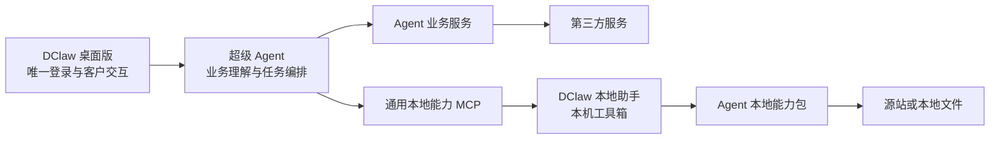

# DClaw 超级 Agent 本地执行标准 V1

状态：`contract-stable`

标准标识：`dclaw.local-execution`

当前版本：`1.2`

平台实现状态：`pending`

截至 2026-10-20，`dclaw-server` 已实现 `local.execution.session/1` 的能力授权、短期会话令牌和本标准的机器 Schema，但尚未实现八个 `local_*` 工具的公共生产网关、通用设备任务服务或通用 Windows 本地助手。大字报仓库中的 Relay 与 `Dazibao.Runner` 属于业务参考和旧版兼容实现，不是新 Agent 可直接使用的平台公共生产能力。平台正式发布生产入口、最低版本和能力包注册流程前，新 Agent 不得根据本文猜测生产地址或宣称已接通公共本地执行链路。

面向第三方开发者的完整开发、密封、上传和协作流程见 [DClaw 第三方超级 Agent 开发、密封与协作标准 V1](super-agent-development-standard-v1.zh-CN.md)。本文只定义本地执行边界与协议。

## 1. 目标

本标准定义超级 Agent 如何通过公共本地能力网关调用 DClaw 本地助手。它只标准化公共通信、任务生命周期、错误定位、能力包和兼容规则，不规定任何行业业务流程。

满足本标准的超级 Agent 可以拥有自己的业务 MCP Server、第三方 API、业务规则和本地能力包，同时复用同一个 DClaw 平台、本地能力网关和本地助手。

从零开发第三方超级 Agent 时，以 [DClaw 第三方超级 Agent 开发、密封与协作标准 V1](super-agent-development-standard-v1.zh-CN.md) 作为入口；从 WorkBuddy、豆包等平台迁移时，再按 [超级专家开发与跨平台迁移操作标准 V1](super-expert-porting-playbook-v1.zh-CN.md) 执行迁移阶段。



图中的第三方服务只由 Agent 业务服务选择和调用；本地能力网关不参与供应商选择。能力包由超级 Agent 发布，本地助手只负责按 MCP 调用加载与执行。DClaw 桌面版是唯一用户入口，本地助手不提供第二套登录或业务流程。

## 2. 强制责任边界

### 2.1 DClaw 平台

负责：

- 对话、会话身份、密封 Agent 托管和运行时；
- 桌面端唯一的用户登录、首次安装引导和设备上下文；
- 通用交互卡与客户输入回传；
- MCP 客户端连接和工具调用；
- 把当前登录会话的短期任务授权交给本地助手；
- 公共审计和调用 trace 传播。

禁止：

- 选择行业第三方 API；
- 实现素材筛选、视频生产或其他 Agent 业务规则；
- 根据业务内容修改本地任务参数。

### 2.2 超级 Agent

超级 Agent 是业务唯一所有者，由 Agent 工作区、业务 MCP Server、业务连接器和本地能力包共同组成。

负责：

- 理解客户意图和决定业务流程；
- 选择第三方 API、供应商和降级策略；
- 管理业务凭证及业务数据；
- 把明确、已校验的任务提交给本地能力网关；
- 根据结构化结果决定下一步并生成客户可见说明。

禁止把业务决策下沉到 DClaw 平台、本地能力网关或 Runner 核心。

### 2.3 通用本地能力 MCP 与网关

本地能力网关是公共基础设施。当前历史代码称其为 Relay。

负责：

- 接收 DClaw 桌面版已经建立的设备上下文，不发起独立用户登录；
- 在线状态和协议协商；
- 通用能力目录、能力包准备和版本检查；
- 持久任务、幂等、检查点、取消和断线续跑；
- Runner 长连接、任务投递和状态回传；
- 产物登记、受控上传和下载授权；
- 统一错误信封与 trace 传播。

禁止出现行业平台名、第三方供应商名、业务筛选条件或业务流程分支。

### 2.4 DClaw 本地助手

DClaw 本地助手是随 DClaw 桌面版使用的通用 Windows 工具箱，不是独立客户端。客户只登录 DClaw 桌面版；首次调用需要本地能力的超级 Agent 时，由桌面版引导安装并自动建立本机上下文，客户不在本地助手中再次登录或输入绑定码。

负责：

- 单实例、安装、更新和与桌面版连接；
- 按 MCP 调用安装、加载和执行能力包；
- 创建统一任务目录并区分客户成品与过程资源；
- 浏览器、本地文件和桌面软件等设备侧公共能力；
- 任务状态、检查点、日志摘要和产物元数据回传。

本地助手不理解业务字段，不规划任务，不选择第三方 API，不决定业务重试或业务结果是否合格，也不建立第二套用户、Agent 或业务权限系统。任务是否合法、选择哪个能力、如何组合工具以及结果是否满足业务要求，全部由 DClaw 会话和超级 Agent 负责。

本地助手只保留执行工具所必需的技术检查：MCP 参数可解析、能力包可加载、目标路径可写、进程可启动，以及结果文件真实存在。不得把这些检查扩展为业务审核或重复状态机。

### 2.5 Agent 本地能力包

能力包属于发布它的超级 Agent，Runner 仅托管执行。能力包可以实现本地下载、剪辑、浏览器操作、文件处理和模型推理，但不能修改公共网关或 Runner 核心。

能力包必须声明输入、结果、检查点、权限、网络范围、资源限制和公开错误。

### 2.6 第三方服务

调用哪一个第三方服务由超级 Agent 决定。长期凭证保存在 Agent 业务服务，不进入提示词、公共网关、Runner 任务或能力包。需要本地直连时只签发最小权限、短时有效的授权或资源 URL。

## 3. 数据与成本原则

- 服务端只传输控制消息、小型结构化数据和必要的最终产物。
- 大文件由 Runner 从受信源站直接下载，禁止默认经过 DClaw 或公共网关中转。
- 高 CPU、内存、磁盘和长时间任务默认在本地执行。
- 第三方 API 返回资源 URL 后，超级 Agent决定是否提交本地任务。
- 本地产物默认保留在客户设备；业务明确需要时才上传。

### 3.1 Windows 本地目录标准

所有超级 Agent 共用一个平台目录：

```text
%LocalAppData%\DClawLocalTool\
└─ tasks\
   └─ <Agent 在 DClaw 中的显示名称>\
      └─ <任务时间-任务短编号>\
         ├─ <客户可直接使用的成品>
         └─ res\
            └─ <素材、缓存、中间文件、日志和任务元数据>
```

强制规则：

1. `tasks` 下一级目录使用 DClaw 提供的 Agent 显示名称，必须与界面显示一致。本地助手不得根据 `agent_id` 猜名称。
2. 每次任务使用独立目录；任务目录名保证可排序和唯一，但不得替代 Agent 显示名称。
3. 最终 MP4、图片、文档等客户成品直接放在任务目录第一层。
4. 下载素材、临时文件、字幕、封面工程、检查点、日志和内部 JSON 全部放在 `res`。
5. MCP 结果必须分别声明 `outputs` 与 `resources`；DClaw 默认只向客户突出展示 `outputs`。
6. 失败任务不得把半成品放在任务根目录；诊断内容保留在 `res`。
7. 平台根目录固定为 `DClawLocalTool`，不得使用某个 Agent 或能力的名称。

## 4. 通用 MCP 工具

### 4.1 命名规则

- 公共 MCP 工具固定使用 `local_*`，不能包含任一超级 Agent、行业或供应商缩写。
- Agent 工作区的 MCP 客户端键统一使用 `local_capability_gateway`。
- 每个超级 Agent 使用符合自身业务语义的稳定 `agent_id`；标准不规定 `dzb` 或任何其他业务前缀。
- 公共网关使用部署配置维护允许接入的 Agent ID，不得在验证代码中硬编码某一个业务 Agent。
- Agent ID 必须来自 DClaw 签名会话。网关用它隔离任务、检查点和幂等空间；Agent 不得把 `agent_id` 作为工具参数自行传入。
- `dzb_*` 一类业务缩写工具名只能作为旧版兼容入口，新 Agent 不得声明或调用。
- 能力 ID 和能力包 ID 归超级 Agent 所有，应表达业务能力并避免全局冲突；它们不是平台公共 API。
- 已发布的 Agent ID 属于持久身份，可为兼容签名和安装记录保留旧值。保留身份不代表公共协议继续使用旧命名。

### 4.2 工具集合

V1 定义八个公共工具：

| 工具 | 责任 |
|---|---|
| `local_environment_status` | 检查安装、在线和协议兼容状态 |
| `local_capabilities_list` | 读取当前设备可用能力目录 |
| `local_runtime_prepare` | 为选定能力准备受信运行时和能力包 |
| `local_task_start` | 幂等创建一个本地任务 |
| `local_task_continue` | 使用当前检查点继续同一任务 |
| `local_task_status` | 只读查询任务状态和当前检查点 |
| `local_task_cancel` | 幂等取消任务 |
| `local_task_result` | 读取终态结果和产物 |

公共工具只接受通用字段。业务输入必须完整封装在 `input` 中，并由能力描述符的 JSON Schema 校验。

八个工具的精确请求结构必须符合 [tool-call.schema.json](contracts/local-execution/v1/tool-call.schema.json)。`dclaw_session_token` 是平台注入的会话字段，不是超级 Agent 或客户选择的业务参数。

每个 V1 工具返回：

```json
{
  "standard": {"id": "dclaw.local-execution", "version": "1.0"},
  "ok": true,
  "trace_id": "0199...",
  "data": {}
}
```

工具级失败返回 `ok=false` 和第 5 节错误信封。工具调用成功但本地任务失败时，顶层仍为 `ok=true`，任务数据中的 `status=failed`，并在 `data.error` 中携带相同错误信封。

## 5. 错误定位标准

每个错误必须明确归属于以下一层：

- `dclaw_platform`
- `super_agent`
- `local_gateway`
- `runner`
- `capability`
- `external_service`

错误信封必须符合 [error-envelope.schema.json](contracts/local-execution/v1/error-envelope.schema.json)，至少包含：

- `code`：带责任域的稳定错误码；
- `legacy_code`：兼容旧 Agent 的原始错误码，可选；
- `source.layer`：错误责任层；
- `source.component`：发生错误的组件；
- `source.operation`：失败操作；
- `category`：参数、认证、连接、资源、超时、外部服务等稳定分类；
- `retryable`：相同状态下是否允许重试；
- `user_action`：客户、管理员或系统下一动作；
- `public_message`：可安全展示的说明；
- `trace_id`：跨 DClaw、Agent MCP、本地网关、Runner 和能力包关联日志的标识。

不得把堆栈、凭证、Cookie、本机路径、内部下载地址或原始第三方响应放入公开错误信封。详细诊断只进入按 `trace_id` 关联的服务端或本地日志。

错误归属按最初失败点确定，转发层不得把上游错误改成自己的泛化错误。例如第三方 API 凭证无效归属 `external_service`；能力包只是转发时不能改成 `runner` 错误。

## 6. 版本与向下兼容

标准版本使用 `major.minor`：

- major：允许破坏性变化，必须使用并存的新工具名或新端点；
- minor：只能增加可选字段、枚举值协商或新工具；
- 文档修订：不改变线上的结构和语义。

兼容要求：

1. 同一 major 内，新服务必须接受旧 minor 请求。
2. 新响应只增加字段，旧字段的含义不得改变。
3. 未识别的响应字段必须被调用方忽略。
4. 枚举扩展必须通过 `features` 协商，不能让旧 Agent 猜测。
5. major 升级时，网关和 Runner 至少同时支持当前 major 与前一个 major。
6. 旧工具在兼容期保持原始参数、结果和错误行为，不得静默改成新信封。
7. 能力包声明 `minimum_runner_version`、`contract_version` 和所需 `features`；不兼容时失败关闭。

大字报现有 `dzb_*` 工具属于 V0 兼容入口。V1 新实现使用 `local_*` 工具，V0 工具继续服务已经发布的旧 Agent。

## 7. 依赖方向

允许：

```text
DClaw -> 超级 Agent -> Agent 业务服务/业务 MCP
超级 Agent -> 公共本地能力 MCP -> 本地能力网关 -> Runner
Runner -> Agent 能力包
Agent 业务服务 -> 第三方 API
```

禁止：

- DClaw 平台导入任一 Agent 业务模块；
- 公共网关导入任一 Agent 的业务规则；
- Runner 核心引用具体 Agent、行业平台或供应商；
- 能力包反向修改网关数据库或绕过任务协议；
- Agent 业务服务把长期凭证下发到本地任务。

物理上暂时部署在同一进程不改变逻辑边界。模块必须保持单向依赖，并能通过边界测试证明。

## 8. 新超级 Agent 交付物

每个采用本标准的超级 Agent 必须交付：

1. Agent 工作区和版本清单；
2. 业务 MCP 工具契约及第三方连接器；
3. 一个或多个签名本地能力包；
4. 输入、结果和检查点 JSON Schema；
5. 业务错误目录及其标准错误映射；
6. 兼容矩阵；
7. 单元、契约、断线恢复和 Windows 真实链路验收证据。

## 9. 验收门槛

新 Agent 接入不得修改 DClaw 平台、公共网关或 Runner 核心。若必须修改，说明缺少公共能力，应先独立设计、版本化并验证该公共能力，再由 Agent 使用。

标准实现必须通过：

- 架构边界测试；
- V1 JSON Schema 契约测试；
- V0 兼容回归；
- 错误层、组件、操作和 trace 完整性测试；
- 幂等、检查点、断线恢复和重复事件测试；
- Windows 安装、升级、连接和真实能力执行测试。

## 10. 标准维护

所有变化先更新 [CHANGELOG.md](contracts/local-execution/CHANGELOG.md)，再修改 Schema 和实现。破坏性变化必须新增 major，禁止覆盖已发布版本目录。

标准文档、机器 Schema、参考实现和兼容测试必须在同一个变更中提交。没有兼容测试的版本变更不得发布。
