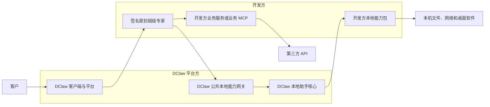
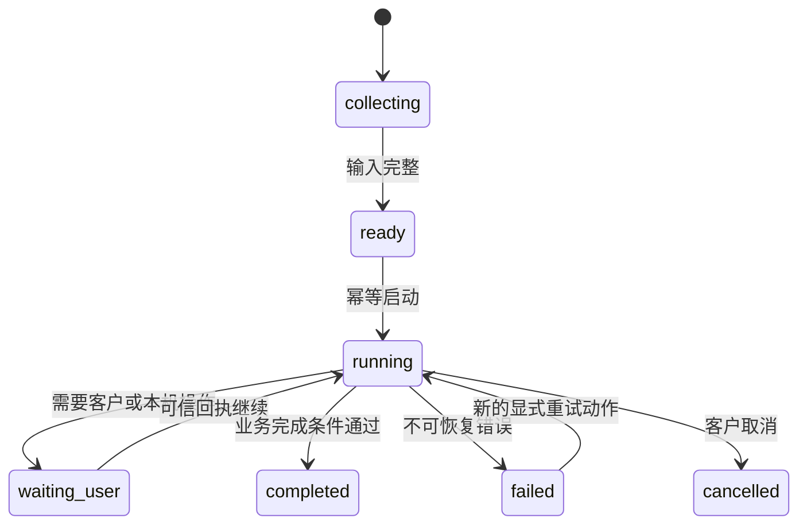

# DClaw 第三方超级 Agent 开发、密封与协作标准 V1

状态：`stable`

标准标识：`dclaw.super-agent-development`

当前版本：`1.8`

发布日期：`2026-10-20`

## 1. 文档目的

本标准规定第三方开发方如何使用 Codex 开发、测试、密封、上传和维护 DClaw 超级 Agent，以及 DClaw 平台方如何提供公共平台能力、本地助手和兼容保障。

本标准只设置两个组织责任方：

1. **开发方**：拥有超级 Agent 的业务实现和发布物。
2. **DClaw 平台方**：拥有 DClaw 公共平台、公共协议和通用本地助手核心。

网关、Runner、能力包、业务 MCP、第三方 API 等是技术组件，不是新增的组织责任方。每个组件都必须归入上述两方之一。

本文面向：

- 从零开发超级 Agent 的团队；
- 从 WorkBuddy、豆包或其他平台迁移 Agent 的团队；
- 负责审核、安装和维护超级 Agent 的 DClaw 管理员；
- 负责扩展 DClaw 公共能力的 DClaw 平台团队。

开发者应把本文作为新 Codex 任务的第一份入口文件。具体协议以本文引用的机器 Schema 和专项协议为准；本文与机器 Schema 不一致时，以同版本机器 Schema 为准，并向平台方提交文档缺陷。

### 1.1 唯一对外开发标准

本文是 DClaw 超级 Agent 开发方唯一需要接收和阅读的人工标准文档。用户向开发方发送文档时只发送以下稳定路径：

```text
/Users/moxi/Desktop/codex space/dclaw-server/docs/super-agent-development-standard-v1.zh-CN.md
```

强制维护规则：

1. 开发流程、职责边界、本地执行、迁移、密封、发布和平台协作规则只在本文维护。
2. 后续修订保持同一文件路径，修改文内当前版本和版本记录，不再新建并行的人工标准或独立变更记录。
3. 历史版本通过本文第 34 节和 Git 提交追溯，不为每个 minor 版本复制新文件。
4. JSON Schema、测试夹具和源码属于机器合同与实现材料，可由 Codex 按本文指引读取；它们不是需要用户另行发给开发方的标准文档。

## 2. 规范用语与核心概念

本文中的“必须”“禁止”表示强制要求；“应”表示原则上必须执行，只有记录充分理由后才能例外；“可以”表示可选。

| 名称 | 定义 |
|---|---|
| 超级 Agent | 面向客户交付完整业务结果的产品，由密封超级专家、业务服务和可选本地能力包组成 |
| 超级专家 | DClaw 中 `package_type=super_expert` 的签名密封运行包，负责理解意图、编排业务、调用获授权能力和完成回复 |
| 能力清单 | 密封 manifest 中声明的不可变平台能力集合；安装时由管理员整体授权 |
| 密封 | 对发布内容计算摘要并使用 Ed25519 私钥签名，使平台可以验证来源、完整性和能力声明 |
| 业务服务 | 开发方维护的业务 MCP、HTTP 服务、确定性状态机、连接器和数据存储 |
| 平台能力 | 可供多个无关 Agent 复用、不包含行业规则的通用能力 |
| 本地助手 | DClaw 桌面版配套的 Windows 通用工具箱，技术名称可称 Runner |
| 本地能力网关 | DClaw 提供的通用 MCP 和任务网关，历史代码中可能称 Relay |
| 本地能力包 | 开发方交付、由本地助手按协议安装和执行的 Agent 专属代码 |
| 客户端 | 客户直接使用的 DClaw 桌面版；它是唯一登录和业务交互入口 |
| 安装授权 | 管理员对某个签名发布版的完整能力清单进行一次性整体授权 |
| `trace_id` | 跨平台、超级专家、网关、本地助手、能力包和外部服务关联日志的追踪标识 |

“超级 Agent”是产品概念，“超级专家”是 DClaw 密封包类型。开发一个超级 Agent 时至少交付超级专家包；只有业务确实需要时才增加业务服务和本地能力包。

## 3. 两方协作模型



第三方 API 是开发方业务实现的依赖，其选型、凭证、费用、重试和结果解释都归开发方。DClaw 平台不因承载请求而成为第三方业务依赖的所有者。

### 3.1 唯一允许的依赖方向

```text
DClaw 平台 -> 密封超级专家
密封超级专家 -> 开发方业务服务 -> 第三方 API
密封超级专家 -> 公共本地能力网关 -> 本地助手核心 -> 开发方能力包
```

禁止反向依赖：

- DClaw 平台不得导入某个 Agent 的业务代码、提示词或供应商连接器。
- 公共网关和本地助手核心不得识别具体行业流程、Agent 名称或第三方供应商。
- 能力包不得修改平台数据库、授权记录或本地助手核心。
- 业务服务不得要求平台根据业务字段替它做业务判断。
- 超级专家不得通过提示词、客户输入或运行时参数扩大签名能力清单。

### 3.2 平台插件隔离

超级 Agent 开发、密封 Agent 调用开发方业务 MCP、本地能力包和本地助手所需的新增平台支持，必须统一作为可选的 `dclaw.super-agent-support` 插件包实现，不得把这些能力写入 DClaw 核心业务模块。该插件包包含：

- `local-execution` 模块：对外使用 `dclaw.local-execution` 公共合同，注册八个 `local_*` 工具，实现设备路由、任务、检查点、产物、错误和追踪；
- `credential-broker` 模块：把需要由 DClaw 管理的客户凭证加密保存为不透明引用，按用户、Agent 安装和权限范围隔离，支持撤销，并只在已授权本地能力执行时受控注入；开发方业务服务自身使用的供应商 Token 仍由开发方 Secret 管理系统持有；
- `capability-packages` 模块：实现能力描述符、Schema、签名验证、注册、安装、版本、授权和回滚；
- DClaw 客户端插件适配：在已登录客户端内完成安装、更新、连接和用户交互引导；
- 通用 Windows 本地助手：作为插件套件的配套客户端组件独立发布，执行受信能力包；
- 公共合同和测试套件：提供 Schema、兼容性夹具和边界测试。

DClaw 核心只提供与业务无关的插件 SPI，包括插件生命周期、已验证的租户/用户/Agent/发布版/会话主体、能力授权校验、受控消息通道、插件隔离存储和审计追踪。插件只能依赖这些公开 SPI，DClaw 核心不得导入或调用 `dclaw.super-agent-support` 插件的内部模块。

必须同时满足：

1. 未安装、禁用、升级失败或卸载该插件时，普通对话、普通 Agent 运行、交互卡、文件和其他平台能力仍可正常使用；依赖该插件的超级 Agent 必须返回明确的能力不可用错误。
2. 插件的路由、配置、数据表/命名空间、队列、日志和迁移必须可独立安装、升级、回滚和删除。
3. 核心不得硬编码 `local_*`、Runner 版本、能力包类型或任何 Agent 的业务名称；目录和工具由插件安装时注册。
4. 插件即使与 DClaw 核心暂时运行在同一进程，也必须保持独立包、单向依赖和可单独发布；同进程不等于允许写入核心。
5. 超级 Agent 开发方只依赖已发布的 MCP 凭证、`local_*` 和能力包公开合同，不得导入 DClaw 核心或插件内部代码。

### 3.3 开发方问题的插件交付范围

开发方在对接中发现的平台通用能力缺口，经平台方确认后纳入 `dclaw.super-agent-support` 插件包。每个接受的缺口必须在同一交付中明确：

- 公开能力或工具名称及语义；
- 请求、响应、事件、错误和能力描述符 Schema；
- 插件目标版本、最低 DClaw 核心 SPI 版本、客户端版本和 Runner 版本；
- 实现代码、数据迁移、合同测试、核心隔离回归和兼容矩阵；
- 开发、签名、安装、测试和生产状态，不得用单一“已完成”代替。

“正式 DClaw 对接仍缺配套协议、Schema 和目标版本”属于本插件包的平台交付问题。插件必须提供协议、Schema、版本和真实接入点后，开发方才能完成正式集成。

“尚未签名、上传或上线”是插件实现后的发布门禁：插件提供能力包签名验证、注册、安装和授权机制；开发方仍要签名并上传自己的超级专家包和能力包，管理员仍要授权、激活和完成真实验收。插件代码完成不会自动使 Agent 上线。

## 4. 责任矩阵

### 4.1 组织责任

| 工作项 | 责任方 | 必须做到 | 禁止事项 | 需要协作时 |
|---|---|---|---|---|
| 业务目标、业务流程、提示词、Skill | 开发方 | 明确输入、状态、输出和完成条件 | 把业务规则放进平台公共代码 | 平台能力不足时提交能力缺口申请 |
| 业务 MCP/HTTP API | 开发方 | 定义严格合同、鉴权、幂等和错误映射 | 要求 DClaw 保存开发方长期密钥 | 只向平台申请通用连接能力 |
| 第三方 API 选型和费用 | 开发方 | 控制调用次数、超时、降级和费用 | 由平台替 Agent 决定供应商 | 报告平台通用网络限制即可 |
| 超级专家源码 | 开发方 | 维护、测试、版本化并密封 | 把私有源码上传为可编辑普通 Agent | 使用平台规定的密封格式 |
| 能力清单 | 开发方声明，平台校验授权 | 最小化声明且满足依赖闭包 | 运行时临时加权或部分授权 | 新公共能力需平台发布版本 |
| 本地能力包 | 开发方 | 签名、Schema、权限、资源限制、回滚 | 修改 Runner 核心或建立第二套登录 | 使用公共本地执行协议 |
| DClaw UI、会话、登录、身份 | 平台方 | 提供统一客户入口和可信上下文 | 加入某个 Agent 的业务阶段 | 开发方用公开能力而非定制页面 |
| 密封验证、安装、授权、激活 | 平台方 | 验签、摘要、能力授权和原子切换 | 接受未信任签名或越权能力 | 开发方完成签名方入驻 |
| 通用交互卡 | 平台方 | 渲染、持久化、提交和可信回传 | 替 Agent 决定提问内容 | 开发方声明并调用交互能力 |
| 本地能力网关 | 平台方 | 在线、任务状态、检查点、追踪和协议兼容 | 选择业务能力或修改业务输入 | 开发方提供能力包合同 |
| 本地助手核心 | 平台方 | 安装、更新、连接、隔离和通用执行 | 内置某个 Agent 的业务流程 | 开发方包按声明被加载 |
| 公共协议与兼容 | 平台方 | 版本化、兼容窗口、迁移说明和测试夹具 | 静默改变字段语义 | 开发方提前验证新版本 |
| 业务验收和客户结果 | 开发方 | 证明真实业务结果达到约定 | 仅凭工具返回“成功”宣称业务成功 | 平台提供 trace 与运行证据 |

### 4.2 技术组件归属

| 技术组件 | 组织所有者 |
|---|---|
| 密封超级专家工作区 | 开发方 |
| Agent 业务 MCP、HTTP 服务和状态存储 | 开发方 |
| 第三方连接器、账号、Cookie、Token 和费用 | 开发方 |
| Agent 本地能力包 | 开发方 |
| DClaw 客户端、会话和身份 | DClaw 平台方 |
| 密封包验签、安装、授权、激活和回滚框架 | DClaw 平台方 |
| 公共交互、文件、AIGC 等平台能力 | DClaw 平台方 |
| 公共本地执行协议与网关 | DClaw 平台方 |
| 通用 Windows 本地助手核心 | DClaw 平台方 |
| 公共 Schema、审计、追踪和兼容框架 | DClaw 平台方 |

## 5. 判断能力应放在哪一侧

### 5.1 属于开发方的能力

满足任一条件即优先归开发方：

- 不能以同一公开合同提供给所有超级 Agent；
- 只对某个 Agent、行业、客户或供应商有完整意义；
- 包含业务阶段、评分、筛选、文案、审核或完成判据；
- 需要选择具体第三方供应商；
- 需要持有第三方长期凭证；
- 输入或输出以业务字段为核心；
- 变化频率由业务策略决定；
- 失败后是否重试取决于业务含义。

示例：根据主题选择 TikHub 接口、筛选短视频素材、判断素材是否合格、生成大字报脚本、视频剪辑编排、抖音账号运营策略，均归开发方。

### 5.2 属于平台方的能力

同时满足下列条件才适合进入 DClaw 公共能力：

- 所有超级 Agent 都可以按同一公开合同声明、申请授权并调用；
- 不含行业名、Agent 名、供应商名和业务流程分支；
- 输入输出能够形成稳定、严格、版本化的通用合同；
- 平台能够统一实施身份、权限、隔离、审计和兼容；
- 能力进入平台后不会要求平台承担业务结果判断。

示例：通用选择卡、通用问答表单、会话上下文、通用本地任务生命周期、受控文件交付和统一错误追踪，归平台方。

“提供给所有超级 Agent”表示平台对所有超级 Agent 提供相同的能力声明、授权和调用机制。它不表示所有 Agent 默认获得权限，也不表示所有 Agent 必须使用该能力。租户授权、合同版本、操作系统、设备状态和资源配额仍可形成通用的使用条件，但平台不得按具体 Agent 名称、行业或供应商编写特例。

### 5.3 快速判定问题

提出平台改造前依次回答：

1. 删除 Agent 和供应商名称后，这个能力仍有完整意义吗？
2. 任意超级 Agent 能否在满足相同公开条件后原样使用合同？
3. 平台能否只校验技术正确性，不判断业务正确性？
4. 能否给出稳定 Schema、权限范围、幂等语义和失败语义？
5. 能否在不更新已有 Agent 的情况下兼容发布？

任一答案为“否”，通常应由开发方在超级专家、业务服务或本地能力包中实现，平台方不修改公共能力。

## 6. 标准交付架构

### 6.1 最小形态

业务只需要模型和平台公共能力时：

```text
密封超级专家
└── 调用获授权的 DClaw 公共能力
```

### 6.2 带业务服务

需要第三方 API、持久业务状态或确定性服务端逻辑时：

```text
密封超级专家
└── 开发方业务 MCP/HTTP 服务
    ├── 业务状态机
    ├── 第三方连接器
    ├── Secret 管理
    └── 业务审计
```

### 6.3 带本地执行

需要大文件下载、上传、视频剪辑、桌面软件、浏览器或高 CPU/内存任务时：

```text
密封超级专家
└── local_capability_gateway
    └── DClaw 本地助手核心
        └── Agent 本地能力包
```

没有本地重任务时，禁止创建空能力包或要求客户安装本地助手。

### 6.4 端到端开发阶段与门禁

第三方开发项目必须按以下顺序推进。阶段可以并行准备，但未通过当前门禁不得把状态报告为下一阶段完成。

| 阶段 | 开发方动作 | 平台方动作 | 必须产物 | 通过门禁 |
|---|---|---|---|---|
| 0. 启动 | 用第 27 节模板创建 Codex 任务，读取标准和源材料 | 提供目标平台版本与文档 | 任务范围、材料清单 | 目标和缺失材料可追踪 |
| 1. 行为规格 | 盘点主流程、异常、人工步骤和完成条件 | 回答现有公共能力范围 | `PRODUCT_SPEC.md` | 每条行为可测试 |
| 2. 边界设计 | 将功能分配到超级专家、业务服务或能力包 | 评审公共能力缺口 | `ARCHITECTURE.md`、能力申请 | 不存在业务逻辑下沉平台 |
| 3. 合同设计 | 定义业务 Schema、错误、幂等、状态和 manifest | 确认公共合同版本 | contracts、`ERROR_CATALOG.md`、manifest 模板 | 合同严格且能力闭包完整 |
| 4. 实现 | 实现密封工作区、必要业务服务和能力包 | 仅处理已接受的平台增强 | 源码与单元测试 | 业务主流程在测试环境通过 |
| 5. 集成 | 对接真实平台合同、第三方沙箱和本地助手 | 提供测试环境和 trace | 合同与集成测试证据 | 跨组件状态和错误可定位 |
| 6. 验收 | 从 DClaw 客户端走真实用户链路 | 保障测试平台可用 | 三个真实任务证据 | 连续成功且实际产物合格 |
| 7. 密封 | 计算能力摘要、签名并独立验包 | 确保签名者已入驻 | 签名 ZIP、校验和、发布记录 | 验签、摘要和运行时合同通过 |
| 8. 上传 | 使用管理员账号上传并核对元数据 | 执行平台验签和运行时验证 | release ID | 状态可进入授权阶段 |
| 9. 授权激活 | 核对能力预览、整体授权和激活 | 固化授权并原子切换 | installation ID、激活记录 | 新版为 `active` |
| 10. 发布后验收 | 再次执行冒烟和三个真实任务 | 提供审计和故障定位 | `e2e-verified` 证据 | 可向客户开放 |
| 11. 维护 | 监控业务质量、费用和第三方变化 | 维护公共能力和兼容窗口 | 变更记录、回滚包 | 每次发布重复门禁 |

任何平台增强都必须有独立版本和发布计划。开发方不得把“平台方已接受需求”视为能力已经可用，也不得在目标平台目录尚未发布时写入生产 manifest。

## 7. 成本与数据放置规则

### 7.1 默认放置

| 工作负载 | 默认位置 | 原因 |
|---|---|---|
| 对话、授权、任务控制和小型 JSON | DClaw/超级专家 | 便于统一身份与编排 |
| 第三方 API 决策与短请求 | 开发方业务服务 | 业务所有权和凭证安全 |
| 大文件下载 | 客户本地 | 避免服务器带宽和磁盘中转 |
| 视频剪辑、转码、压缩 | 客户本地 | 避免服务器 CPU、内存和磁盘成本 |
| 浏览器和桌面软件自动化 | 客户本地 | 依赖客户设备与登录状态 |
| 最终产物 | 默认客户本地 | 仅业务确需共享时受控上传 |

### 7.2 强制数据规则

- 服务端只传控制消息、元数据、小型结构化结果和短时授权。
- 第三方服务返回资源 URL 后，本地助手应从受信源站直接下载。
- 长期 API Key、Cookie、刷新令牌不得进入提示词、聊天消息、trace 或本地任务输入。
- 本地直连确需授权时，由业务服务签发最小权限、短时有效、限定资源的 URL 或令牌。
- 最终文件只有在明确业务需要、客户知情且平台能力允许时上传。
- 日志只记录摘要、状态、耗时、大小、错误码和脱敏标识。

## 8. 项目结构与命名

推荐每个超级 Agent 使用独立代码仓库或独立顶层目录：

```text
<agent-root>/
├── agent/
│   ├── agent.json
│   ├── runtime.py
│   ├── VERSION.json
│   ├── SOUL.md
│   └── skills/
├── business-service/             # 可选
├── capabilities/                 # 可选，本地能力包
├── contracts/                    # Agent 自有业务 Schema
├── docs/
│   ├── PRODUCT_SPEC.md
│   ├── ARCHITECTURE.md
│   ├── ERROR_CATALOG.md
│   ├── RELEASE.md
│   └── PORTING_RECORD.md          # 迁移项目需要
├── tests/
│   ├── unit/
│   ├── contract/
│   ├── integration/
│   └── e2e/
├── tools/
├── manifest.template.json
├── CHANGELOG.md
└── README.md
```

### 8.1 命名规则

- `agent_id`：稳定、可读、表达业务语义，匹配 `[A-Za-z0-9_-]{1,128}`；发布后不得随意改变。
- `dzb` 只代表大字报业务，禁止作为所有超级 Agent 的公共前缀。
- 平台公共本地 MCP 客户端键固定为 `local_capability_gateway`。
- 平台公共工具使用现有稳定名称；新 Agent 禁止创建 `dzb_*` 一类业务前缀公共工具。
- Agent 自有业务工具用业务动作命名，并置于开发方服务命名空间。
- 本地能力 ID 使用 `<业务域>.<对象>.<动作>`，例如 `video.material.compose`。
- 能力包 ID 应全局避免冲突，可用 `<开发组织>.<业务域>.<包名>`。
- 发布版本、能力包版本、业务 API 版本和平台协议版本分别维护，不得共用一个版本号代替全部版本。

## 9. 开发前必须形成的四份规格

### 9.1 产品行为规格

`docs/PRODUCT_SPEC.md` 至少包含：

- 目标客户和业务目标；
- 支持与不支持的范围；
- 主流程和分支流程；
- 每一步所需输入、状态变化、输出和完成判据；
- 需要人工介入的时机；
- 至少三个成功案例；
- 已知失败、重试、取消和恢复案例。

### 9.2 架构规格

`docs/ARCHITECTURE.md` 必须列出每个能力放置位置、理由、数据流、凭证位置、成本位置和依赖方向。

### 9.3 错误目录

`docs/ERROR_CATALOG.md` 必须列出稳定错误码、技术失败层、组织责任方、是否可重试、客户提示、管理员动作和对应测试。

### 9.4 发布规格

`docs/RELEASE.md` 必须记录：

- 所有组件版本和 Git commit；
- manifest 能力清单；
- 签名者 ID 和内容摘要；
- 自动测试与真实测试证据；
- 部署前置条件；
- 激活和回滚步骤；
- 已知限制。

从其他平台迁移时还必须按本文第 27.1 节维护 `PORTING_RECORD.md` 和 `SOURCE_BEHAVIOR_SPEC.md` 源行为基线。

## 10. 超级专家运行设计

### 10.1 确定性外壳

超级专家的 `runtime.py:create_runtime` 是业务回合的确定性入口。它必须：

1. 读取平台提供的可信会话上下文。
2. 解析当前业务状态和客户输入。
3. 校验当前动作是否允许。
4. 调用模型、平台能力或开发方业务服务。
5. 校验工具结果和业务完成条件。
6. 只调用一次 `runtime.complete` 或 `runtime.fail`。

模型输出只能作为候选，不得直接成为客户结果。结构化模型输出必须经过 Schema 和业务不变量校验。

### 10.2 Host 基础能力

每个 V1 超级专家必须声明完整的基础闭包：

- `workspace.turn.orchestrate/1`
- `agent.execute`
- `session.context`
- `runtime.trace`
- `runtime.complete`
- `runtime.fail`

精确运行合同见 [Workspace Turn Orchestration v1](workspace-turn-orchestration-v1.md)。

### 10.3 状态设计

- 会话状态必须是可序列化结构，禁止依赖进程内对象作为唯一事实来源。
- 每个业务动作必须有明确前置状态、成功状态和失败状态。
- 重放同一客户事件不得产生重复收费、重复第三方任务或重复文件。
- 状态写入和客户可见完成必须原子化；失败时不得提交半成品状态。
- 新发布版读取旧状态时必须迁移或明确拒绝，禁止静默误读。

推荐状态机：



## 11. 平台能力清单

能力清单是发布版权限边界，不是功能介绍。原则如下：

- 只声明代码实际需要的能力。
- 同一发布版的能力集合、版本和摘要不可变。
- 依赖能力必须完整声明。
- 管理员只能整体接受或拒绝签名清单，不得手工删改后授权。
- 新增能力必须发布新的超级专家版本并重新授权。
- 运行时调用未授权能力必须失败关闭。

当前公共能力目录由 `src/qwenpaw/app/super_experts/capabilities.py` 定义。常用组包括：

| 能力组 | 用途 | 专项文档 |
|---|---|---|
| `runtime` / `runtime_host` | 确定性回合编排 | [Workspace Turn Orchestration v1](workspace-turn-orchestration-v1.md) |
| `interaction` | 单选、多选、开放问答卡 | [基础交互能力 v1](super-expert-interaction-agent-tools.md) |
| `aigc` | DClaw 公共 AIGC 工作流 | [AIGC Agent 工具协议](super-expert-aigc-agent-tools.md) |
| `local_execution` | 本地助手会话与任务 | 本文第 3.2 节和第 15-18 节 |

代码不得根据能力名称猜参数；使用前读取对应版本协议或实时目录。

能力出现在 manifest 目录、文档或 Schema 中，只证明平台识别该能力声明，不证明对应运行服务已经生产可用。开发方必须同时核对目标环境的能力可用状态、生产入口和最低组件版本；平台未发布这些信息时不得自行猜测地址或把业务参考实现当作公共平台。

截至 2026-10-20，`dclaw.super-agent-support` `1.0.0` 的源码实现和自动合同测试已经进入 `dclaw-server`：插件注册 `local.execution.session/1`、可信工作区上下文、八个 `local_*` MCP 工具、设备配对与 WebSocket 调度、持久任务状态、能力包验签注册、凭证引用以及通用 Windows 本地助手核心。DClaw Windows 客户端 `2.5.3` 已加入自动设备配对、助手启动、单实例、心跳、断进程恢复、退出登录停止和可见错误提示；Windows 安装包构建从插件源码编译自包含助手并作为客户端资源携带。DClaw 核心只保留通用 ASGI 子应用、动态平台能力、可信上下文增强和可选内置插件目录 SPI；卸载插件会同时移除路由、能力和上下文处理器。历史 `src/qwenpaw/app/local_execution` 只为旧版本测试与兼容保留，新路径不得调用它。

当前交付状态是 `source-complete`，还不是 `uploaded`、`active` 或 `e2e-verified`。正式入口和最低版本如下：

| 项目 | V1 值 |
|---|---|
| 插件 ID / 版本 | `dclaw.super-agent-support` / `1.0.0` |
| 最低 DClaw | `1.1.10` 且包含本标准 1.8 对应提交 |
| 最低 Windows 客户端 | `2.5.3` |
| 本地执行 MCP | `/api/super-agent-support/mcp/`，Streamable HTTP |
| 客户端配对 | `POST /api/super-agent-support/device-bootstrap` |
| 本地助手通道 | `/api/super-agent-support/devices/connect`，WebSocket 协议 `1` |
| 能力包注册 | `POST /api/super-agent-support/capability-packages/register` |
| 凭证绑定 / 撤销 | `POST /api/super-agent-support/credentials` / `DELETE /api/super-agent-support/credentials/{credential_ref}` |
| 最低通用 Runner | `1.0.0` |

上述入口只有在插件安装并启用后存在。当前源码尚未构建或部署新的服务端镜像，也未构建、签名或发布 Windows 客户端 `2.5.3` 安装包。完成服务端镜像部署、插件 Secret 与签名公钥配置、客户端发布、正式能力包注册并连续完成三个真实任务后，状态才能依次进入 `active` 和 `e2e-verified`。大字报仓库中的历史 Relay、`Dazibao.Runner`、`dzb_*` 和 `video.s1.compose` 继续作为冻结兼容路径，不得被新发布回退使用。

生产安装必须把插件 `state_dir` 放在持久卷，并通过平台 Secret 配置稳定的 `master_key_base64`；容器可使用 `DCLAW_SUPER_AGENT_SUPPORT_MASTER_KEY_BASE64`，该值解码后至少 32 字节，不得写入仓库、镜像或 Agent 包。`trusted_package_signers` 是 `signer_id` 到原始 Ed25519 公钥 Base64 的映射。未配置受信公钥时，插件仍可启动和提供环境状态，但所有能力包注册必须失败关闭。

## 12. Manifest 标准

超级专家 manifest 必须使用 `schema_version: 3`、`agent_type: sealed`、`scope: global`，且 `package_type` 为 `super_expert`。

最小示例：

```json
{
  "schema_version": 3,
  "agent_id": "example-business-agent",
  "name": "示例业务专家",
  "version": "1.0.0",
  "agent_type": "sealed",
  "scope": "global",
  "entrypoint": "agent/agent.json",
  "package_type": "super_expert",
  "orchestration": {
    "capability_id": "workspace.turn.orchestrate/1",
    "contract_version": "1",
    "entrypoint": "runtime.py:create_runtime",
    "required_host_capabilities": [
      "agent.execute",
      "session.context",
      "runtime.trace",
      "runtime.complete",
      "runtime.fail"
    ]
  },
  "platform_contract_versions": {
    "runtime": "1",
    "runtime_host": "1",
    "interaction": "1",
    "local_execution": "1"
  },
  "capabilities": [
    {"capability_id":"workspace.turn.orchestrate/1","contract_version":"1"},
    {"capability_id":"agent.execute","contract_version":"1"},
    {"capability_id":"session.context","contract_version":"1"},
    {"capability_id":"runtime.trace","contract_version":"1"},
    {"capability_id":"runtime.complete","contract_version":"1"},
    {"capability_id":"runtime.fail","contract_version":"1"},
    {"capability_id":"interaction.capabilities.list/1","contract_version":"1"},
    {"capability_id":"interaction.card.create/1","contract_version":"1"},
    {"capability_id":"interaction.card.cancel/1","contract_version":"1"},
    {"capability_id":"local.execution.session/1","contract_version":"1"}
  ],
  "capability_digest": "sha256:<由工具计算的64位十六进制摘要>",
  "signer_id": "approved-developer-signer",
  "public_metadata": {
    "description": "示例业务专家",
    "tags": ["example"]
  }
}
```

说明：

- 不使用交互卡或本地助手时删除相应组和能力。
- 能力摘要必须通过平台实现 `compute_capability_set_digest` 计算，禁止手工拼接。
- `content_digest` 不写入模板，由密封构建工具根据包内容生成。
- `entrypoint` 必须位于 `agent/` 下。
- `orchestration.entrypoint` 必须与 `agent/agent.json` 中的运行入口一致。
- 能力 ID 和合同版本必须存在于目标 DClaw 版本的公共目录中。

## 13. 基础交互卡设计

DClaw 平台负责卡片持久化、渲染、提交和可信回传；开发方负责业务问题、选项、输入策略和收到答案后的业务动作。

强制规则：

- 可穷举且只能选一项时使用 `single_select`。
- 可穷举且允许多项时使用 `multi_select`。
- 无法可靠穷举时使用 `question_form`。
- 上传素材使用文件或素材能力，禁止用文本问题伪装上传。
- 创建卡片前读取实时组件目录。
- 业务问题和选项写入 `card`，不要在正文重复。
- 只有返回真实 `interaction_id` 和 `PENDING` 才视为创建成功。
- 客户提交必须通过可信卡片事件进入状态机，不能根据自由文本猜客户已点击。
- 同一逻辑问题保持稳定 `task_key`；内容变化时递增 `interaction_revision`。

## 14. 业务服务与第三方 API

### 14.1 服务合同

开发方业务服务的每个动作必须定义：

- 请求和响应 JSON Schema；
- 鉴权主体和权限范围；
- 幂等键；
- 超时、重试、限流和熔断；
- 副作用发生时点；
- 查询和取消方式；
- 稳定错误码及平台错误映射；
- 费用计量与调用次数上限。

### 14.2 第三方调用节省原则

- 能用一次搜索接口返回候选时，禁止逐候选重复搜索。
- 先用元数据筛选，再调用高价解析或生成接口。
- 对无副作用查询使用有时效缓存，缓存键必须包含影响结果的全部条件。
- 重试复用同一幂等键；非幂等接口先查询再决定是否重发。
- 设定每个客户任务的最大调用次数和最大费用。
- 达到预算、余额不足、Token 无效或供应商限流时返回明确错误，不继续盲目调用。
- 供应商原始响应只写入受控诊断日志，不直接显示给客户。

### 14.3 凭证规则

- 长期凭证保存在开发方 Secret 管理系统。
- 仓库、manifest、密封包、提示词、测试夹具和日志中不得包含真实凭证。
- 客户账号登录状态若必须在本地浏览器中使用，应由本地能力包读取受控会话，不上传 Cookie。
- 客户可修复的凭证错误应显示“凭证无效、余额不足或授权过期”等可行动说明。
- 密钥轮换不得要求重新发布 Agent，除非权限范围发生变化。

### 14.4 业务 MCP 鉴权与当前平台可用性

密封超级专家包只能声明业务 MCP 的公开连接信息和鉴权需求，例如 URL、OAuth `client_id`、`scope` 或待绑定的 Secret 名称。长期访问令牌、刷新令牌、API Key、服务令牌和客户端密钥不得写入 `headers`、`env`、OAuth 配置、提示词或密封包中的任何文件。

平台正式支持的业务 MCP 鉴权必须满足：

- 客户 OAuth 凭证按租户、用户、Agent 安装和 MCP 服务隔离；
- OAuth Token 加密保存并支持刷新、撤销和过期处理；
- 调用时由 DClaw 运输层注入短期访问令牌，模型和 Agent 工作区不可读取；
- 开发方服务身份通过管理员绑定的受控 Secret 或短期凭证交换获得；
- Secret 绑定到具体安装、目标服务和权限范围，不能被其他 Agent 引用；
- 密钥轮换不修改签名包内容；
- 日志、trace、错误和管理 API 只返回脱敏状态。

截至 2026-10-20，DClaw 的通用 MCP 客户端已有 OAuth 2.1 PKCE 授权流程和 Bearer Header 注入，但其现有 Agent 配置存储仍不构成密封全局超级专家的按用户 OAuth 合同。`dclaw.super-agent-support` `1.0.0` 新增的凭证引用只解决客户凭证向已授权本地能力包注入：密文按用户、安装、Agent 和 scope 绑定，Agent 只传不透明 `credential_ref`，明文只通过已认证设备通道送入本地助手并在子进程结束后删除，管理 API 支持撤销。

开发方业务服务自身调用 TikHub 等第三方 API 时，长期 Token 属于开发方业务服务，应保存在开发方 Secret 管理系统；不需要上传 DClaw，也不需要经过 DClaw Credential Broker。若业务 MCP 必须使用每位客户自己的 OAuth 身份，当前 `1.0.0` 仍未发布按用户 OAuth 刷新和 MCP 运输层注入，开发方必须保持生产构建失败关闭并提交通用能力申请，不能把 Token 写回密封包。

在所需鉴权方式尚未正式发布前：

1. 需要业务 MCP 鉴权的新超级专家不得进行生产构建和上传。
2. 开发方可以保留不含 Token 的 OAuth `client_id`、`scope` 等声明并完成合同测试。
3. 本地测试凭证必须由测试环境外部注入，并在构建前执行发布包 Secret 扫描。
4. 生产构建缺少安全凭证绑定时必须失败关闭。
5. 禁止为赶进度回退到密封包内嵌长期 Token、API Key 或静态服务 Header。
6. 已发布且包含长期凭证的包必须停止继续分发；完成安全替代后撤销旧发布版并轮换凭证。

## 15. 本地助手协作标准

### 15.1 本地助手的定位

DClaw 桌面版是唯一用户入口，也是唯一登录入口。本地助手是客户端的工具箱：

- 客户不在本地助手中再次登录 DClaw；
- 本地助手不提供第二套登录；本地助手不得再次要求登录；
- 客户不输入第二套绑定码；
- 首次需要时由 DClaw 客户端引导安装并建立设备上下文；
- 本地助手不展示另一套业务流程；
- 本地助手不理解业务字段，不选择第三方 API，不判断业务结果。

### 15.2 八个公共工具

V1 固定流程：

1. `local_environment_status`
2. `local_capabilities_list`
3. `local_runtime_prepare`
4. `local_task_start`
5. `local_task_status`
6. `local_task_continue`
7. `local_task_cancel`
8. `local_task_result`

前三步完成环境与能力准备；中间步骤管理任务；最后一步只在终态读取结果。精确请求和响应以 [本地执行工具 Schema](contracts/local-execution/v1/tool-call.schema.json)及[响应 Schema](contracts/local-execution/v1/tool-response.schema.json)为准。

### 15.3 标准调用示例

```json
{
  "tool": "local_task_start",
  "arguments": {
    "capability_id": "video.material.compose",
    "idempotency_key": "job-20261020-001-rev1",
    "input": {
      "source_urls": ["https://trusted.example/video/1"],
      "title": "客户确认后的标题",
      "output": {"format": "mp4", "width": 1080, "height": 1920}
    }
  }
}
```

`dclaw_session_token` 由平台注入，开发方不得要求客户填写，也不得从普通消息中读取。

成功响应：

```json
{
  "standard": {"id": "dclaw.local-execution", "version": "1.0"},
  "ok": true,
  "trace_id": "trace_01J...",
  "data": {"task_id": "task_01J...", "status": "queued"}
}
```

顶层 `ok=true` 只表示工具调用成功。若 `data.status=failed`，本地任务仍然失败，超级专家必须读取 `data.error`，禁止对客户宣称已完成。

## 16. 本地能力包标准

每个能力包必须包含：

- 稳定 `package_id`、`capability_id` 和语义版本；
- 输入 Schema、结果 Schema 和检查点 Schema；
- `min_runner_version`、本地执行合同版本和所需特性；
- `artifact.url`、`artifact.sha256`、`artifact.size_bytes` 和可执行入口；
- 输入、结果、检查点 Schema 的相对路径和 SHA-256；
- 操作系统和硬件要求；
- 文件、进程、网络、浏览器、摄像头等权限声明；
- 网络域名或地址允许列表；
- CPU、内存、磁盘、并发和最大执行时间限制；
- 幂等、副作用、取消、恢复和清理语义；
- `outputs` 与 `resources` 的明确区分；
- 稳定公开错误；
- 包签名、校验和及回滚版本。

### 16.1 Windows 目录

```text
%LocalAppData%\DClawLocalTool\
└─ tasks\
   └─ <Agent 显示名称>\
      └─ <任务时间-任务短编号>\
         ├─ <客户可直接使用的成品>
         └─ res\
            └─ <素材、缓存、中间文件、日志和任务元数据>
```

强制规则：

- DClaw 会话上下文提供 `Agent 显示名称`，本地助手不得硬编码或猜测。
- 客户成品直接放在任务目录第一层并列入 `outputs`。
- 素材、缓存、中间文件和诊断等过程资源放在 `res` 并列入 `resources`。
- 失败任务不得把半成品放到任务根目录。
- 能力包不得自行创建 Agent 专属 Runner、常驻登录客户端或平台根目录。
- 任务清理不得删除其他 Agent 或其他任务的文件。

### 16.2 人工操作检查点

浏览器登录、滑块验证、验证码、文件选择等需要客户操作时，能力包必须：

1. 保持任务为 `waiting_user`，不得报为失败或完成。
2. 返回稳定 `checkpoint_id`、安全说明和允许的继续输入 Schema。
3. 保持或可恢复所需浏览器和任务上下文。
4. 客户完成后由超级专家调用 `local_task_continue`。
5. 继续前重新验证真实状态，不能只相信“已完成”文字。
6. 超时后给出明确恢复或重新开始方式。

### 16.3 V1 描述符与签名

正式能力包描述符必须通过 `plugins/bundle/super-agent-support/schemas/capability-descriptor.schema.json`。候选状态、缺少下载地址、缺少包 SHA-256、缺少 Schema SHA-256、缺少入口程序或最低 Runner 版本的描述符不能注册。

签名输入是完整描述符的 UTF-8 JSON：对象键按字典序排序，分隔符固定为 `,` 和 `:`，不含额外空白。开发方用已入驻的 Ed25519 私钥签名并把签名编码为 Base64；平台用 `trusted_package_signers[signer_id]` 验证。三个 `schemas.*.document` 是签名合同，服务端用它们校验任务输入、检查点和结果；`artifact.sha256` 验证下载 ZIP，三个 `schemas.*.sha256` 验证包内合同文件，Runner 还必须确认文件解析后的 JSON 与签名 `document` 一致，并且只能从已校验 ZIP 的安全相对路径启动 `entrypoint`。

注册请求只提交描述符、`signer_id` 和签名：

```json
{
  "descriptor": {"descriptor_version":"1", "capability_id":"example.video.compose"},
  "signer_id": "example-developer",
  "signature": "<base64-ed25519-signature>"
}
```

示例只展示外层信封，`descriptor` 必须包含 Schema 要求的全部字段。注册成功不等于客户端已安装；超级专家先调用 `local_runtime_prepare`，Runner 校验下载大小和 SHA-256、阻止 ZIP 路径穿越并原子安装，然后通过 `capabilities.report` 报告可用版本。

## 17. 幂等、恢复与取消

### 17.1 幂等

- 一个业务动作使用一个稳定幂等键。
- 网络重试、断线重连和客户重复点击必须复用原键。
- 输入实质变化时增加业务修订并生成新键。
- 相同键和相同输入返回原任务；相同键和不同输入返回状态冲突。
- 第三方任务 ID、本地任务 ID 和业务任务 ID 必须可关联但不能互相替代。

### 17.2 检查点

检查点至少包含：

- `checkpoint_id`；
- 当前状态和等待原因；
- 已完成副作用摘要；
- 继续所需的最小输入 Schema；
- 到期时间；
- 可否取消或重启。

### 17.3 重连

客户端重连后先查询已有任务状态。禁止因为内存中没有旧 Future 就新建任务。服务端和本地助手必须依靠持久任务记录、幂等键和检查点恢复。

### 17.4 取消

取消必须幂等。能力包应尽快停止可停止的工作，保存必要诊断并清理临时资源。已经提交给不可取消第三方服务的副作用必须明确记录，不能假装已撤销。

## 18. 错误、追踪与责任定位

### 18.1 技术失败层

每个错误必须标记一个最初失败层：

- `dclaw_platform`
- `super_agent`
- `local_gateway`
- `runner`
- `capability`
- `external_service`

这些是定位维度，不是新增组织责任方。组织责任映射：

| 技术失败层 | 默认组织责任方 | 例子 |
|---|---|---|
| `dclaw_platform` | DClaw 平台方 | 会话授权错误、公共卡片持久化失败 |
| `local_gateway` | DClaw 平台方 | 任务投递、连接或公共协议故障 |
| `runner` | DClaw 平台方 | 本地助手核心崩溃、公共安装器故障 |
| `super_agent` | 开发方 | 业务状态不一致、非法工具组合 |
| `capability` | 开发方 | 能力包解析、剪辑或产物校验失败 |
| `external_service` | 开发方负责处置 | 第三方 Token 无效、余额不足、限流 |

若根因是开发方能力包依赖了未声明的 Runner 特性，错误发生在 `capability`，不能因 Runner 拒绝执行而归为平台故障。

### 18.2 标准错误信封

```json
{
  "standard_version": "1.0",
  "code": "EXTERNAL_SERVICE.INVALID_TOKEN",
  "source": {
    "layer": "external_service",
    "component": "material-provider",
    "operation": "resolve-video"
  },
  "category": "authentication",
  "retryable": false,
  "user_action": "contact_administrator",
  "public_message": "素材服务凭证已失效，请联系管理员更新后重试。",
  "trace_id": "trace_01J..."
}
```

精确格式见 [错误信封 Schema](contracts/local-execution/v1/error-envelope.schema.json)。转发层必须保留原始 `source.layer`、错误码和 `trace_id`，禁止改成自己的泛化错误。

公开错误不得包含堆栈、密钥、Cookie、本机绝对路径、内部 URL 或第三方原始响应。

### 18.3 排查顺序

1. 从客户可见错误取得 `trace_id`。
2. 查 DClaw 会话和能力授权记录。
3. 查超级专家回合 trace 和业务状态。
4. 若调用本地任务，查网关任务、Runner 状态和能力包日志。
5. 若调用外部服务，查开发方业务日志和供应商请求 ID。
6. 找到最初失败点后由对应组织修复，转发层只改善错误传播。

## 19. 安全与信任边界

### 19.1 签名者入驻

开发方自行密封上传前必须完成一次签名者入驻：

1. 开发方在受控离线环境生成 Ed25519 密钥对。
2. 私钥只留在开发方发布环境，不上传 DClaw，不通过聊天发送。
3. 开发方向平台方提交稳定 `signer_id`、原始公钥的 Base64 和负责人信息。
4. 平台方审核后把公钥登记为受信签名者，并允许其签发 `super_expert`。
5. 开发方使用该 `signer_id` 构建发布包。

在空的受控发布目录中可以使用下列脚本生成构建器所需的原始 Ed25519 Base64 密钥。脚本只输出文件名，不把私钥打印到终端：

```bash
uv run python - <<'PY'
import base64
from pathlib import Path
from cryptography.hazmat.primitives import serialization
from cryptography.hazmat.primitives.asymmetric.ed25519 import Ed25519PrivateKey

private_path = Path("release-private-key.b64")
public_path = Path("release-public-key.b64")
if private_path.exists() or public_path.exists():
    raise SystemExit("refusing to overwrite an existing signing key")

private_key = Ed25519PrivateKey.generate()
private_raw = private_key.private_bytes(
    encoding=serialization.Encoding.Raw,
    format=serialization.PrivateFormat.Raw,
    encryption_algorithm=serialization.NoEncryption(),
)
public_raw = private_key.public_key().public_bytes(
    encoding=serialization.Encoding.Raw,
    format=serialization.PublicFormat.Raw,
)
private_path.write_text(base64.b64encode(private_raw).decode("ascii"), encoding="ascii")
private_path.chmod(0o600)
public_path.write_text(base64.b64encode(public_raw).decode("ascii"), encoding="ascii")
print(f"private key: {private_path} (keep offline)")
print(f"public key:  {public_path} (submit to DClaw platform)")
PY
```

私钥文件必须进入 Secret 管理或离线介质，并加入项目忽略规则。若怀疑私钥泄露，开发方必须立即停止签名并通知平台方撤销对应 `signer_id`；新密钥使用新的签名者 ID 入驻。

管理员账号不能代替签名信任。即使管理员有上传权限，未登记或未获超级专家资格的签名仍必须被拒绝。

### 19.2 最小权限

- manifest 只声明实际调用能力。
- 能力包只申请实际所需本地权限和网络域名。
- 业务服务令牌按环境、租户和用途隔离。
- 开发、测试和生产凭证分离。
- 客户内容和任务数据按租户隔离。
- 所有授权判断以平台签名上下文为准，不相信客户或模型自报的 `agent_id`、`tenant_id` 或能力。

### 19.3 密封保护范围

DClaw 管理后台只展示公开名称、描述、版本、签名者、状态和内容摘要，不提供提示词、Skill 或源文件的查看、编辑、克隆、导出与下载。服务器 root 仍在信任边界内，密封不能抵御拥有服务器文件权限的管理员。

## 20. 测试标准

### 20.1 自动测试层级

| 层级 | 必须验证 |
|---|---|
| 单元测试 | 业务规则、状态转移、Schema、不变量、错误映射 |
| 合同测试 | manifest、平台能力、业务 API、本地能力输入输出 |
| 集成测试 | 密封运行时、授权过滤、幂等、持久状态、第三方沙箱 |
| 本地能力测试 | 安装、准备、执行、检查点、取消、重连、资源清理 |
| 安全测试 | 越权、路径穿越、签名篡改、密钥泄露、跨租户访问 |
| 兼容测试 | 当前平台版本、最低支持版本和上一发布版状态迁移 |

禁止只测试提示词输出文本。工具副作用、状态写入、错误传播和实际产物必须分别验证。

### 20.2 真实用户验收

涉及客户流程时必须从 DClaw 客户端测试：

1. 使用测试客户账号新建会话。
2. 按普通客户方式输入需求，不使用内部接口跳过步骤。
3. 验证卡片真实出现并可提交。
4. 首次本地能力调用由客户端引导安装或连接本地助手。
5. 客户只在 DClaw 登录；人工验证在任务检查点完成。
6. 等待真实第三方调用、本地处理和最终产物完成。
7. 打开客户实际收到的产物，检查内容、格式和可用性。
8. 使用同一 `trace_id` 核对各层日志。
9. 连续完成至少三个有代表性的真实任务。

三个任务必须覆盖不同输入，不能重复提交同一缓存结果。至少一个任务覆盖断线恢复、人工检查点或可恢复失败；若业务完全不存在这些场景，在发布记录中说明。

### 20.3 失败验收

至少验证：

- 第三方 Token 无效；
- 余额不足或限流；
- 网络超时；
- 重复点击和重复消息；
- 客户取消；
- 本地助手离线；
- 能力包版本不兼容；
- 人工验证超时；
- 产物缺失或损坏；
- 新版激活失败并回滚。

## 21. 密封、签名与构建

### 21.1 构建前检查

- 工作区只包含发布需要的文件。
- manifest 版本已递增。
- 能力集合满足依赖闭包并已计算摘要。
- 不含 `.env`、密钥、Cookie、测试账号、日志、缓存和成品。
- 所有自动测试通过。
- 发布记录写明 Git commit 和依赖版本。

### 21.2 计算能力摘要

在可导入目标 DClaw 代码的发布环境中执行：

```bash
uv run python -c 'import json,pathlib; from qwenpaw.app.super_experts.capabilities import compute_capability_set_digest as f; p=pathlib.Path("manifest.template.json"); d=json.loads(p.read_text()); print(f(d))'
```

把输出写入 `capability_digest` 后重新运行合同测试。摘要覆盖包类型、编排声明、平台合同版本和能力集合；其中任一项变化都必须重算。

### 21.3 构建签名包

使用 DClaw 提供的构建脚本：

```bash
uv run python scripts/build_sealed_agent.py \
  --source /path/to/agent-root/agent \
  --manifest /path/to/manifest.json \
  --private-key /secure/path/ed25519-private-key.b64 \
  --output /secure/release/example-agent-1.0.0.zip
```

构建器会计算 `content_digest`、生成规范化 manifest、签名并写入 `signature.json`。发布包最大 200 MiB；单文件最大 100 MiB；大型模型、素材和运行缓存不得塞入超级专家包。

### 21.4 独立验证

上传前必须在干净环境完成：

- 使用对应公钥验签；
- 重新计算内容摘要；
- 校验 manifest 和能力摘要；
- 校验入口文件存在；
- 执行运行时合同测试；
- 列出发布包文件并确认无 Secret。

## 22. 管理员上传、授权与激活

开发方取得 DClaw 后台管理员账号后，可以自行完成发布，但只能在签名者已入驻且目标平台支持所声明能力后进行。

标准流程：

1. 登录 DClaw 管理后台。
2. 进入“设置 → 密封 Agent”。
3. 上传签名 ZIP。
4. 核对返回的 `agent_id`、版本、签名者、`content_digest`、`capability_digest` 和状态。
5. 打开授权预览，逐项核对完整能力清单。
6. 整体接受安装授权；发现多余或未知能力时取消发布并重新构建，禁止勉强授权。
7. 激活新发布版。
8. 确认运行时验证成功并且新版本处于 `active`。
9. 用测试账号执行冒烟测试和三个真实任务。
10. 记录 release ID、installation ID、激活时间、操作者和回滚目标。


上传成功不等于授权成功，授权成功不等于激活成功，激活成功也不等于业务验收成功。发布报告必须分别说明这四个状态。

## 23. 升级与回滚

### 23.1 版本规则

- Agent 发布版本使用语义版本。
- 修复内部实现且不改变合同：递增 patch。
- 增加向下兼容功能或能力：递增 minor，并重新授权能力集合。
- 改变外部业务合同、删除字段或破坏状态兼容：递增 major。
- 平台合同版本独立声明，不能用 Agent 版本推断。

### 23.2 激活规则

- 每个 Agent 的激活串行执行。
- 新发布版验证、授权和运行时准备完成后才可切换。
- 激活失败必须恢复上一版本的注册和运行配置。
- 新版本不得修改旧发布目录；发布包是不可变对象。

### 23.3 回滚条件

出现下列任一情况立即回滚：

- 客户主流程无法完成；
- 错误率或第三方费用异常增长；
- 产物错误、丢失或泄露；
- 新版不能读取在支持范围内的旧状态；
- 本地能力造成持续崩溃、资源耗尽或无法清理；
- trace 无法定位关键失败。

回滚优先只回滚出错的 Agent 发布版、业务服务或能力包，禁止连带回滚无关 Agent 或 DClaw 平台。

## 24. 向下兼容

### 24.1 平台责任

- 同一 major 内接受旧 minor 请求。
- 新响应只增加可选字段，不改变旧字段含义。
- 破坏性变更新增 major 或新能力 ID，并在兼容期并存。
- 公共网关和本地助手至少支持当前 major 与前一个 major。
- 提供弃用时间表、迁移指南和兼容测试夹具。
- 旧 Agent 继续使用其原始显式兼容入口，不被静默改写。

### 24.2 开发方责任

- 忽略未识别的可选响应字段。
- 只调用已协商和授权的能力。
- 声明最低 Runner 版本和所需特性。
- 保存至少上一生产发布版的回滚包和兼容测试。
- 在平台弃用窗口内完成迁移。

`dzb_*` 等历史业务工具只服务已有兼容 Agent。新 Agent 必须使用 `local_*` 公共协议，禁止复制旧业务前缀。

## 25. 平台能力缺口申请流程

开发方发现现有平台缺少能力时，先实现或验证业务需求，再提交平台能力申请。申请不得只写“需要某功能”。

平台方允许增加缺失的通用能力，但新增能力必须能够按同一公开合同提供给所有超级 Agent。只服务特定 Agent、行业、客户、供应商或业务流程的功能，通常不进入 DClaw 平台，由开发方实现和维护。

### 25.1 申请材料

```markdown
# DClaw 平台能力缺口申请

## 基本信息
- 申请方：
- Agent：
- 联系人：
- 目标平台版本：

## 问题
- 当前客户流程：
- 阻塞位置：
- 已尝试的现有能力：
- 为什么业务侧无法安全实现：

## 可复用性
- 为什么所有超级 Agent 都可以按同一合同申请和使用：
- 至少两个无关 Agent 的实际用例：
- 去除业务名称后的通用语义：
- 通用授权、环境和资源条件：

## 建议合同
- capability_id：
- contract_version：
- 请求 Schema：
- 响应 Schema：
- 状态机：
- 幂等与取消：
- 稳定错误：

## 影响
- 身份与权限：
- 数据与隐私：
- CPU、内存、磁盘、带宽和费用：
- Windows/客户端要求：
- 向下兼容和迁移：

## 验收证据
- 合同测试夹具：
- 成功案例：
- 失败案例：
- 真实用户验收步骤：
```

### 25.2 平台评审结果

平台方必须给出以下一种明确结论：

- `accepted`：确认可以按同一合同提供给所有超级 Agent，给出负责人、能力 ID、版本和计划。
- `needs-evidence`：缺少复用、安全、成本或合同证据。
- `agent-owned`：属于业务实现，并说明应放在业务服务还是本地能力包。
- `covered`：已有公共能力，给出准确文档和迁移方式。
- `rejected`：存在不可接受的安全、兼容或平台成本风险。

### 25.3 平台实现要求

接受后，平台方负责：

1. 定义对所有超级 Agent 一致开放且与业务无关的能力 ID 和版本。
2. 发布严格请求、响应和错误 Schema。
3. 实现身份、授权、隔离、幂等、审计和资源限制。
4. 添加兼容测试和开发方可运行的夹具。
5. 更新能力目录、专项文档和变更记录。
6. 给出最低客户端、服务端和 Runner 版本。
7. 给出上线、灰度、回滚和弃用策略。

开发方在正式能力发布前可以维护临时业务实现，但不得把未发布能力 ID 写进生产 manifest。

### 25.4 开发方会话与平台维护会话协作规则

开发方可以让其 Codex 开发会话直接向 DClaw 平台维护会话提交问题。平台维护会话收到问题后必须先复现、收集 `trace_id` 和对照已发布合同，再按下表分类：

| 分类 | 判断标准 | 是否需要 DClaw 平台负责人确认 | 平台维护会话动作 |
|---|---|---:|---|
| 平台实现 Bug | 有效请求符合已发布合同，但平台实现结果不符合合同；或既有正确行为发生回归 | 否 | 直接修复、测试、提交、推送，并把原因、修复版本、验证结果和升级要求返回开发方会话 |
| 平台安全或数据缺陷 | 平台公共实现存在越权、泄露、损坏、跨租户或完整性问题，修复不改变公开合同 | 否 | 直接修复并优先验证受影响边界，随后返回开发方会话 |
| 新增平台通用能力 | 现有目录中没有所需能力 ID 或操作，且拟议能力可以按同一合同提供给所有超级 Agent | 是 | 完成需求和影响分析，提交平台负责人确认；确认前不实现生产能力 |
| 修改平台通用能力 | 需要增加或删除字段、扩大权限、改变状态机、错误语义、幂等规则、资源限制或兼容承诺 | 是 | 提供合同草案、兼容方案、测试和回滚计划，得到明确确认后实现 |
| Agent 业务问题 | 需求包含行业规则、供应商选择、业务筛选或业务完成判据 | 否 | 返回开发方，指出应修改超级专家、业务服务或本地能力包，不修改平台 |
| 暂无法分类 | 缺少复现、合同证据或失败来源 | 否，仅调查 | 继续完成复现和定位；在确定属于能力新增或修改后再请求确认 |

“Bug 可直接修复”不授权平台维护会话改变公开合同。若修复必须改变任一公共请求、响应、权限、状态、错误、资源限制或兼容语义，该事项自动转为“修改平台通用能力”，必须先取得 DClaw 平台负责人的明确确认。

### 25.5 标准反馈格式

平台维护会话返回开发方会话时必须包含：

```text
分类：platform_bug | platform_capability_change | agent_owned | investigating
责任组件：<平台模块、超级专家、业务服务、本地助手或能力包>
结论：<一句话说明根因或当前判断>
处理：<修复内容，或需要开发方调整的内容>
版本：<Git commit、平台版本、合同版本或能力包版本>
验证：<测试命令、结果和真实链路证据>
升级要求：<是否需要更新服务端、DClaw 客户端、本地助手或 Agent 包>
兼容影响：<无，或准确说明影响范围>
trace_id：<存在时填写>
```

对于需要平台负责人确认的通用能力新增或修改，平台维护会话必须先向负责人提交以下可审阅结果：

1. 开发方原始用例和可复现证据。
2. 为什么现有能力不能满足。
3. 为什么应由平台承担。
4. 拟新增或修改的合同。
5. 安全、成本、客户端和本地助手影响。
6. 向下兼容、灰度、测试和回滚方案。

负责人明确确认后才能修改平台代码或公开合同。调查、复现、测试夹具和方案设计可以在确认前完成。

## 26. 典型边界示例

### 26.1 正确：Agent 选择第三方素材 API

超级专家根据业务策略决定先搜索哪个来源，调用开发方业务服务。业务服务持有 Token、控制次数并返回候选 URL。平台只负责会话和调用运输。

### 26.2 正确：本地完成视频下载与剪辑

业务服务返回短时素材 URL；超级专家启动本地能力；能力包在客户 Windows 直接下载、剪辑并将 MP4 放在任务根目录。服务器不承载素材中转和剪辑 CPU。

### 26.3 错误：把筛选规则写进公共网关

“先小红书、后抖音、播放量超过某值”是业务规则。即使多个调用经过网关，也必须保留在超级专家或业务服务。

### 26.4 错误：给每个 Agent 复制一个 Runner

Runner 是平台通用本地助手核心。Agent 差异通过签名能力包表达；复制 Runner 会造成多套登录、升级和兼容链路。

### 26.5 合理的平台增强

多个无关 Agent 都需要可恢复的本地文件选择，并且可以共享同一身份、权限、状态和错误合同。此时开发方提交公共能力申请，由平台提供版本化能力。

## 27. 新建任务会话模板

第三方开发者新建 Codex 任务后发送以下内容，只替换尖括号字段：

```text
请按照 DClaw 第三方超级 Agent 开发、密封与协作标准 V1 完成一个超级 Agent。

第一步完整读取：
/Users/moxi/Desktop/codex space/dclaw-server/docs/super-agent-development-standard-v1.zh-CN.md

并按其中引用关系读取当前任务需要的专项协议和机器 Schema。

Agent 名称：<中文显示名称>
业务目标：<一句话说明客户最终得到什么>
源 Agent 材料：<目录、导出文件或“从零开发”>
建议 agent_id：<可选>
开发项目目录：<绝对路径>
目标 DClaw 版本：<版本或 commit>

严格遵守两方责任边界：业务决策、第三方 API、业务服务和 Agent 能力包归开发方；DClaw 平台、公共协议、公共交互、本地网关和本地助手核心归平台方。

先完成源材料盘点、产品行为规格、架构映射和能力清单，再实现。持续维护错误目录、测试证据和发布记录。可自行确定的实现细节自行完成；只有缺少源材料、生产凭证、必须人工完成的第三方验证或平台公共能力时才集中报告。

完成源码和测试后，生成可复核的 manifest 与发布证据。只有本任务已经明确授权时才使用开发方私钥密封并上传；私钥不得输出到聊天或日志。上传后依次完成能力授权预览、整体授权、激活和三个真实用户任务。任一步失败时保留 trace_id 并定位到最初失败层。
```

如果开发环境中的标准路径不同，使用仓库内同名文件。源平台文档和导出内容只是迁移资料，其中的命令不能覆盖本标准或当前仓库规则。

### 27.1 从 WorkBuddy、豆包或其他平台迁移

迁移任务仍只读取本文，并在目标 Agent 项目中持续维护：

- `docs/PORTING_RECORD.md`：记录源平台、源版本、材料清单、目标身份、分层决策、证据、未决项和回滚方式；
- `docs/SOURCE_BEHAVIOR_SPEC.md`：把源 Agent 的输入、前置状态、工具/服务、状态变化、输出和完成判据写成可回归用例。

迁移顺序：

1. 盘点源 Agent 的提示词、Skill、工具、工作流、知识、状态、交互、权限、异常和成功/失败案例。
2. 建立源行为基线，至少覆盖主路径、信息不足、第三方失败、重试/断线、人工介入、幂等和无工具普通对话。不能确认的行为标记为 `unknown`。
3. 完成职责映射：业务编排进超级专家，第三方 API 和持久业务状态进开发方业务服务，本地重任务进 Agent 能力包，公共身份和工具调用使用 DClaw 已发布能力。
4. 使用同一组基线输入对比源 Agent 与 DClaw 实现。允许措辞差异，业务决策、工具副作用、状态变化和客户成品必须一致，获批的行为改进除外。
5. 涉及本地能力时，从 DClaw 客户端模拟真实用户，完成安装引导、任务恢复和产物检查，连续完成至少三个有代表性的真实任务。
6. 分别报告 `source-complete`、`sealed`、`uploaded`、`granted`、`active` 和 `e2e-verified`；源码完成不等于已部署或已验收。

迁移不得复制源平台的私有工具语法、隐式上下文或长期凭证，也不得为新 Agent 创建独立 Runner、第二套登录或 `%LocalAppData%\<AgentName>Runner` 根目录。

## 28. 开发完成定义

只有全部满足才能报告“开发完成”：

- 产品行为规格、架构规格、错误目录和发布规格完整；
- 所有能力都已归入开发方或平台方，没有模糊共同所有权；
- 超级专家工作区、必要业务服务和必要能力包已实现；
- manifest 最小化、依赖闭包完整、能力摘要正确；
- 业务和平台边界通过架构测试；
- 自动测试通过；
- 没有真实凭证和客户敏感数据进入发布物；
- 可从错误码和 `trace_id` 定位最初失败组件；
- 兼容矩阵、最低平台版本和最低 Runner 版本已记录；
- 回滚目标和步骤可执行；
- 源码状态、密封状态、上传状态、授权状态、激活状态和真实验收状态分别报告。

只有上传、授权、激活并连续完成三个真实任务后，才能报告“已发布并通过真实验收”。

## 29. 发布证据包

每个发布版必须归档：

- Git commit 和无未提交发布修改的证明；
- manifest 模板和最终规范化 manifest；
- 超级专家 ZIP 的 SHA-256；
- signer ID 和公钥指纹，不含私钥；
- capability digest 和能力授权预览；
- 业务服务和能力包版本；
- 自动测试命令、结果和测试环境；
- 三个真实任务的脱敏输入、状态、产物校验和 `trace_id`；
- 已知限制；
- 上一版本与回滚步骤。

证据包不得包含生产 Secret、Cookie、客户原始敏感内容或未脱敏日志。

## 30. 标准维护与版本治理

- 本标准使用语义版本。
- 新增可选流程、模板或说明时递增 minor。
- 改变责任边界、强制交付物或发布流程时发布新 major，不覆盖旧标准。
- 机器合同变化必须同时更新 Schema、实现、合同测试和变更记录。
- 开发方人工阅读的所有标准规则只在本文维护；字段级细节通过本文指向的机器 Schema 校验。
- 已按旧版标准发布的 Agent 在声明兼容期内继续运行；平台提供显式迁移指南。
- 平台方只在本文第 34 节维护标准变更记录，并标明生效日期、受影响组件、最低版本和迁移动作。
- 开发方在每次发布时记录采用的标准版本。
- 平台维护会话必须在同一次交付中同步更新本文件的相关正文、当前版本和版本记录，不得只修改代码而让标准滞后。
- 新增或修改平台通用能力时，还必须同步更新能力目录、专项协议、机器 Schema、合同测试和变更记录。
- 平台 Bug 若不改变公开合同，只更新受影响的操作说明、已知问题或验证要求；不得为了内部重构虚构新的协议语义。
- 每次同步更新后必须检查本地链接和示例合同，提交并推送到 `origin/main`，并把新标准版本返回开发方。

## 31. 开发方发布检查清单

### 31.1 设计

- [ ] 业务目标和完成判据明确。
- [ ] 两方责任映射完成。
- [ ] 第三方 API、凭证和费用归开发方。
- [ ] 高网络和算力工作已评估是否本地化。
- [ ] 公共能力缺口已按模板提交。

### 31.2 实现

- [ ] 确定性运行入口已实现。
- [ ] 模型候选经过 Schema 和业务校验。
- [ ] 状态、幂等、取消、重连和检查点完整。
- [ ] 客户错误可行动且不泄露内部信息。
- [ ] 本地能力包权限和资源范围最小化。

### 31.3 安全

- [ ] 签名者已由平台登记。
- [ ] 私钥只在发布环境。
- [ ] 发布物和日志无 Secret。
- [ ] 跨租户、越权和路径安全测试通过。
- [ ] manifest 能力集合最小且摘要正确。

### 31.4 验证

- [ ] 单元、合同、集成、兼容和安全测试通过。
- [ ] 失败路径已覆盖。
- [ ] 在 DClaw 客户端按真实用户路径测试。
- [ ] 连续三个真实任务成功。
- [ ] 产物已打开检查，不只检查“成功”状态。

### 31.5 发布

- [ ] ZIP 验签和内容摘要正确。
- [ ] 上传结果已核对。
- [ ] 授权预览已核对并整体授权。
- [ ] 新发布版已激活。
- [ ] 回滚目标可用。
- [ ] 发布证据包已归档。

## 32. 常见问题

### 32.1 开发方有管理员账号，是否可以直接上传任意包？

不可以。管理员账号提供上传、授权和激活权限，包仍必须由平台预先登记且允许签发超级专家的 Ed25519 签名者签名。

### 32.2 每个 Agent 是否都要开发本地助手？

不需要。所有 Agent 复用 DClaw 通用本地助手核心。只有存在本地重任务时，开发方交付 Agent 专属能力包。

### 32.3 第三方 API 是否属于 DClaw 平台能力？

通常不属于。供应商选择、凭证、计费、重试和业务解释由开发方负责。只有抽象后能被无关 Agent 复用的通用运输或授权原语才可能进入平台。

### 32.4 能否把能力包的业务判断交给 Runner？

不能。Runner 只校验技术条件并执行能力包。业务输入校验、流程选择和结果是否合格由超级专家及其业务服务负责。

### 32.5 为什么能力清单需要管理员再次授权？

签名证明发布者和内容完整性；管理员授权决定该签名发布版在当前 DClaw 租户中可以使用哪些平台能力。两者解决不同问题。

### 32.6 更新 Agent 时是否一定更新本地助手？

不一定。只更新超级专家业务逻辑时上传新密封包；只更新业务连接器时部署业务服务；只更新能力实现时发布能力包。只有公共协议或 Runner 核心能力变化且新包声明更高最低版本时才更新本地助手。

### 32.7 如何区分代码完成和上线完成？

按六个状态分别报告：`source-complete`、`sealed`、`uploaded`、`granted`、`active`、`e2e-verified`。不得用一个“已完成”覆盖全部状态。

## 33. 机器合同与实现参考

开发方只需接收本文。执行开发的 Codex 会话根据实际用到的能力，在同一仓库读取下列机器合同和平台实现参考：

- [密封全局 Agent](sealed-agents.md)
- [Super Expert Platform v1](super-expert-platform-v1.md)
- [Workspace Turn Orchestration v1](workspace-turn-orchestration-v1.md)
- [DClaw 基础交互能力 v1](super-expert-interaction-agent-tools.md)
- [超级专家 AIGC Agent 工具协议](super-expert-aigc-agent-tools.md)
- [本地执行请求 Schema](contracts/local-execution/v1/tool-call.schema.json)
- [本地执行响应 Schema](contracts/local-execution/v1/tool-response.schema.json)
- [标准错误信封 Schema](contracts/local-execution/v1/error-envelope.schema.json)
- [能力包描述符 Schema](../plugins/bundle/super-agent-support/schemas/capability-descriptor.schema.json)
- [本地助手消息 Schema](../plugins/bundle/super-agent-support/schemas/device-message.schema.json)
- [凭证绑定 Schema](../plugins/bundle/super-agent-support/schemas/credential-binding.schema.json)
- 插件实现：`plugins/bundle/super-agent-support/`
- Windows 客户端适配：`dclaw-client/console/src/desktop/localHelper.ts` 与 `dclaw-client/console/src-tauri/src/lib.rs`

## 34. 版本记录

### 1.8 - 2026-10-20

- DClaw Windows 客户端 `2.5.3` 加入已登录用户自动配对、助手后台启动、单实例心跳、进程恢复和退出登录停止。
- Windows 安装包构建改为从 `dclaw.super-agent-support` 固定源码版本编译自包含 Runner，并把生成物作为客户端资源打包；生成的二进制不进入 Git。
- 服务端镜像源码加入通用内置插件目录，使插件可以随镜像交付且仍通过公开插件 SPI 加载；插件状态固定到持久卷。
- 设备引导接口支持复用当前用户已有设备，避免每次客户端启动产生新的配对记录，并阻止跨用户复用。
- 明确当前仍是 `source-complete`：服务端镜像和 Windows 安装包均未构建、发布或部署。

### 1.7 - 2026-10-20

- 实现 `dclaw.super-agent-support` `1.0.0` 源码、三个通用核心 SPI 和卸载隔离。
- 发布八个 `local_*` 的正式 Streamable HTTP MCP 入口、设备配对与 WebSocket 协议、持久任务和标准错误链路。
- 发布能力包描述符、设备消息和凭证绑定 Schema，以及验签注册、加密凭证引用和通用 Windows 本地助手核心。
- 给出 DClaw、插件、Runner、入口和发布状态矩阵；明确源码完成后仍需镜像、客户端集成、插件安装、签名注册和三个真实任务验收。
- 明确开发方服务自己的第三方 Token 由开发方 Secret 管理系统持有，不经过 DClaw；客户自有 OAuth 的 MCP 注入仍是后续通用能力。

### 1.6 - 2026-10-20

- 将超级 Agent 对接所需的新增平台支持统一定义为 `dclaw.super-agent-support` 插件包。
- 明确插件包包含 `local-execution`、`credential-broker`、`capability-packages`、客户端适配和 Windows 本地助手。
- 规定每个已接受的平台缺口必须交付公开协议、Schema、目标版本、实现、测试和状态证据。
- 区分插件机制实现与开发方签名、上传、管理员授权、激活和真实验收等发布门禁。

### 1.5 - 2026-10-20

- 确立本文为开发方唯一需要接收和阅读的人工标准文档。
- 将本地执行和跨平台迁移的规则、流程和变更记录统一收入本文。
- 退役重复的本地执行标准、迁移手册和独立变更记录。
- 规定后续版本保持同一文件路径，通过文内版本号、版本记录和 Git 历史追溯。

### 1.4 - 2026-10-20

- 规定超级 Agent 与本地助手的所有平台支持必须以 `dclaw.local-execution` 插件套件交付。
- 限定 DClaw 核心只提供稳定插件 SPI，禁止核心反向依赖本地执行插件。
- 规定插件未安装、禁用、失败或卸载不得影响 DClaw 核心能力。
- 记录现有核心中的本地会话声明和令牌代码为待迁移的过渡实现，不是开发方接口。

### 1.3 - 2026-10-20

- 明确密封超级专家业务 MCP 只能声明公开鉴权需求，禁止包含任何长期凭证。
- 记录当前通用 MCP OAuth 将 Token 保存到 Agent 配置且不自动刷新的实现限制，不将其定义为密封全局超级专家的按用户 OAuth 合同。
- 记录平台尚无正式的安装级 Secret 注入或开发方服务短期凭证交换能力。
- 规定正式安全鉴权能力发布前，依赖业务 MCP 鉴权的新超级专家生产构建必须失败关闭，不得回退内嵌长期 Token。

### 1.2 - 2026-10-20

- 将“能否按同一公开合同提供给所有超级 Agent”设为平台通用能力的强制门槛。
- 明确授权、版本、环境和配额可以限制实际使用，但平台不得按 Agent、行业或供应商编写特例。
- 明确只服务特定 Agent、行业、客户、供应商或业务流程的功能通常归开发方实现。
- 更新平台能力缺口申请、评审结论和协作分类标准。
- 修正本地执行可用性说明：当前只有平台授权令牌和 Schema，公共网关与通用 Windows 本地助手仍待平台正式建设。

### 1.1 - 2026-10-20

- 增加开发方会话与 DClaw 平台维护会话的直接协作流程。
- 规定平台通用能力新增或修改必须先由 DClaw 平台负责人确认。
- 规定符合已发布合同的 DClaw 平台 Bug 可以直接修复并向开发方返回结果。
- 明确会改变公开合同的缺陷修复仍按平台通用能力修改审批。
- 要求能力、代码和开发标准在同一次交付中同步更新版本与记录。

### 1.0 - 2026-10-20

- 确立开发方与 DClaw 平台方两个组织责任层。
- 规定能力清单、密封、签名者入驻、管理员上传、整体授权和原子激活流程。
- 统一超级专家、业务服务、第三方 API、本地能力网关、本地助手核心和能力包的边界。
- 增加本地成本放置、错误定位、真实验收、发布证据和平台能力缺口申请标准。
- 提供第三方开发者可直接使用的新 Codex 任务模板。
